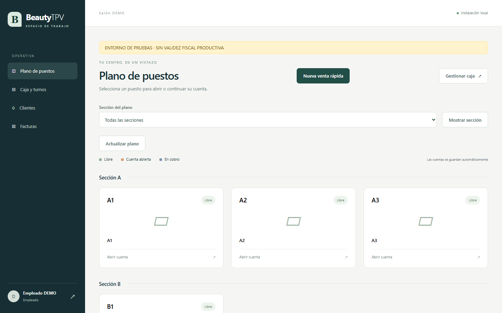
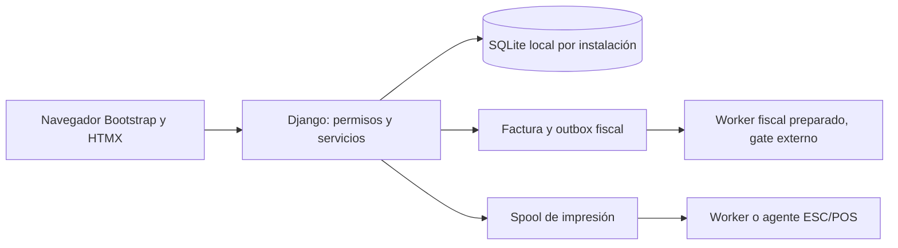

# BeautyTPV

TPV local para salones de estética: plano de puestos, cuentas persistentes, cobros, caja, clientes y facturación. **Una instalación y una SQLite por empresa**, con navegadores de terminal o tablet; sin SaaS ni portal de clientes en V1.



**Versión declarada:0.1.0.** Implementación local y DEMO Windows disponibles; no se declara un lanzamiento estable ni conformidad fiscal productiva. AEAT oficial, declaración responsable suscrita, hardware físico y validación del equipo de destino conservan sus gates externos. La DEMO es TEST, offline y sin validez fiscal productiva.

## Qué permite hacer

- Abrir puestos por secciones, guardar cuentas independientes y recuperarlas al volver o reiniciar.
- Añadir servicios/productos, buscar por categorías, mantener cantidades/notas y aplicar descuentos según permisos.
- Cobrar efectivo, tarjeta confirmada en datáfono externo o pago mixto, con cambio y control de doble cobro.
- Abrir caja, registrar movimientos, arquear/cerrar e informar ventas/IVA/devoluciones autorizadas.
- Gestionar clientes, catálogo, categorías, puestos, cajas y usuarios con jerarquía y auditoría.
- Emitir documentos inmutables, PDF/QR, rectificativas **totales** y registros fiscales con outbox persistente.
- Gestionar impresión ESC/POS, copias y cajón mediante cola; simulador en desarrollo/DEMO y agente remoto por terminal.
- Operar un panel Superadmin propio: diagnóstico, autorizaciones temporales, incidencias, dispositivos, backups y preparación de mantenimiento offline.

Detalle por rol, menú, flujo y límites: [FUNCIONALIDADES](docs/FUNCIONALIDADES.md). Agenda, reservas y portal Cliente son posibilidades futuras, no funciones existentes.

## Tecnologías y requisitos

Python>=3.12, Django5.2, SQLite, Bootstrap5 y HTMX servidos localmente, Waitress, Playwright/pytest y Ruff. Las versiones reproducibles del entorno están en [requirements.lock.txt](requirements.lock.txt); los metadatos del proyecto en [pyproject.toml](pyproject.toml).

Windows10/11 para los accesos de escritorio. El equipo verificado es Windows11; no se atribuye una prueba adicional en Windows10. Se necesita un navegador compatible, permisos sobre la carpeta de instancia y espacio para Python, dependencias y backups. No se ha certificado un mínimo comercial de RAM/CPU ni una capacidad sostenida de terminales.

SQLite debe residir en disco local del servidor. Los terminales acceden por HTTP(S), **nunca comparten el fichero por SMB/NFS**. El despliegue LAN requiere configuración HTTPS, firewall/ACL y aceptación del equipo de destino.

## Empezar en Windows

La preparación inicial requiere Python disponible. Desde una copia autorizada del repositorio:

```powershell
python -m venv .venv
.venv\Scripts\python.exe -m pip install -r requirements.lock.txt
.venv\Scripts\python.exe -m pip install --no-deps -e ".[dev]"
powershell.exe -NoProfile -ExecutionPolicy Bypass -File .\crear_acceso_directo.ps1
```

Si el entorno ya está preparado, no necesita recrearlo. Abra **BeautyTPV DEMO** en el escritorio: prepara una SQLite independiente bajo `%LOCALAPPDATA%\BeautyTPV-DEMO` y abre [la identificación local](http://127.0.0.1:8000/acceso/). **Usuarios BeautyTPV DEMO** muestra las credenciales aleatorias privadas de esa instancia. No hay contraseñas fijas en el repositorio.

Para detener/reiniciar, use **Detener BeautyTPV DEMO** y después el acceso de inicio. También existen [iniciar_beautytpv_demo.bat](iniciar_beautytpv_demo.bat) y [detener_beautytpv_demo.bat](detener_beautytpv_demo.bat). No se instala un servicio de Windows automáticamente ni existe un instalador gráfico de doble clic del producto.

Guías: [arranque DEMO](docs/instalacion/ARRANQUE_DEMO.md), [instalación Windows](docs/instalacion/INSTALACION_WINDOWS.md) y [despliegue local](docs/instalacion/DESPLIEGUE_LOCAL.md). DEMO usa Waitress127.0.0.1:8000 y DEBUG=False. `runserver` se reserva al desarrollo; no es el servidor productivo. `.env.example` es una plantilla y no se carga automáticamente.

## Roles

| Rol | Uso principal | Controles |
|---|---|---|
| Empleado | Plano, cuentas, cobro y documentos propios autorizados | Sin configuración ni informes globales; apertura de caja previa conservada |
| Encargado | Supervisión, descuentos restringidos, movimientos, arqueo/cierre e informes | Sin configuración técnica ni gestión de roles |
| Administrador | Salón, catálogo/plano/cajas, usuarios inferiores y exportaciones autorizadas | Contraseña elevada; no gestiona iguales/superiores ni Superadmins |
| Superadmin | Hereda operativa y administra soporte técnico, dispositivos y mantenimiento | Elevación y scopes; PII exige aprobación independiente de otro Admin |

El PIN no concede elevación. Cliente es una ficha comercial sin acceso propio. [Matriz de permisos](docs/ROLE_PERMISSION_MATRIX.md) y [seguridad](docs/arquitectura/SEGURIDAD.md).

## Arquitectura resumida

Navegador Bootstrap/HTMX → Django (vistas con permisos y servicios transaccionales) → SQLite local. Al cobrar se generan venta, factura, registro/outbox y spool de forma consistente; el transporte se ejecuta fuera de la transacción de venta. No se asume bloqueo de fila en SQLite.



En DEMO no hay worker fiscal ni conexiones externas; solo simulación de impresión. La arquitectura completa, modelos, estados y recuperación están en [docs/README](docs/README.md).

## Fiscalidad y hardware: estado preciso

Implementado localmente: IVA generalS1/01, F1/F2 y rectificación totalR1/R5, snapshots, huella/cadena, XSD/WSDL oficiales fijados, QR y SOAP/outbox/reintentos. No se amplía a regímenes especiales ni devoluciones parciales. **TEST no equivale a homologación, acuse oficial ni autorización productiva.** [VERI*FACTU](docs/integraciones/VERIFACTU.md).

Drivers preparados: ESC/POS TCP, USB y serie; cajón por impresora compatible. Comprobados: simulador, bytes, API y TCP loopback. **Ninguna marca/modelo/firmware físico se declara certificado o probado.** El estado DONE de transporte no confirma papel físico. [Hardware y checklist](docs/integraciones/HARDWARE.md).

## Documentación por perfil

- [Empleado: guía de usuario](docs/manuales/GUIA_USUARIO.md).
- [Administrador: configuración y operaciones](docs/manuales/GUIA_ADMINISTRADOR.md).
- [Superadmin: soporte, dispositivos y mantenimiento](docs/manuales/GUIA_SUPERADMIN.md).
- [Desarrollador: entorno, pruebas y extensiones](docs/desarrollo/GUIA_DESARROLLADOR.md).
- [Índice completo y evidencias históricas](docs/README.md).
- [Auditoría de esta documentación](docs/DOCUMENTATION_AUDIT.md).

## Pruebas y mantenimiento

```powershell
.venv\Scripts\python.exe manage.py check
.venv\Scripts\python.exe manage.py makemigrations --check --dry-run
.venv\Scripts\python.exe -m pytest -q
.venv\Scripts\python.exe -m ruff check .
.venv\Scripts\python.exe -m ruff format --check .
```

Para Chromium y particularidades Windows, consulte [PRUEBAS](docs/desarrollo/PRUEBAS.md). Los resultados actuales se registran con JUnit en la auditoría;112/697/836/893 corresponden a ejecuciones históricas distintas. No se usan insignias de una CI remota no ejecutada.

Backups, restauración y actualización están documentados como operaciones controladas; la web prepara/verifica, **no sustituye SQLite viva ni ejecuta una consola arbitraria**. [Proceso de release](RELEASE_PROCESS.md) y [CHANGELOG](CHANGELOG.md). No se publican versiones automáticamente.

## Licencia, contribuciones y soporte

**GNU AGPLv3 (`AGPL-3.0-only`)**: uso, modificación y distribución permitidos, también comercialmente, conforme a [LICENSE](LICENSE). Al distribuir versiones cubiertas debe proporcionarse el código fuente correspondiente; las versiones modificadas con interacción remota por red deben ofrecerlo a sus usuarios según la sección 13. Las contribuciones mediante PR al [repositorio original](https://github.com/mmateo9601/BeautyTPV) son recomendadas, no obligatorias. Consulte [código fuente y alcance](SOURCE_CODE.md) y [avisos de terceros](THIRD_PARTY_NOTICES.md).

[CONTRIBUTING](CONTRIBUTING.md), [código de conducta](CODE_OF_CONDUCT.md), [seguridad y comunicación privada](SECURITY.md), [soporte](SUPPORT.md). No hay correo, empresa titular o SLA inventados: esos datos deben acordarse con el propietario/instalador antes de distribuir.
