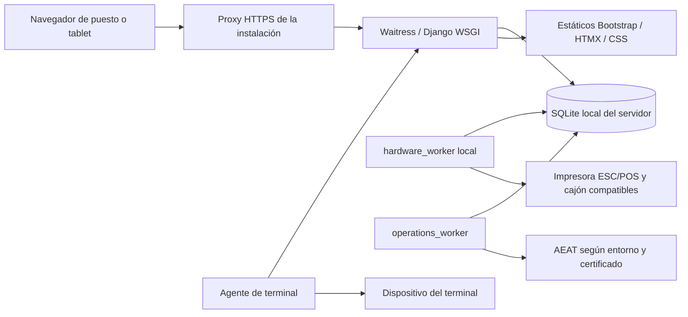
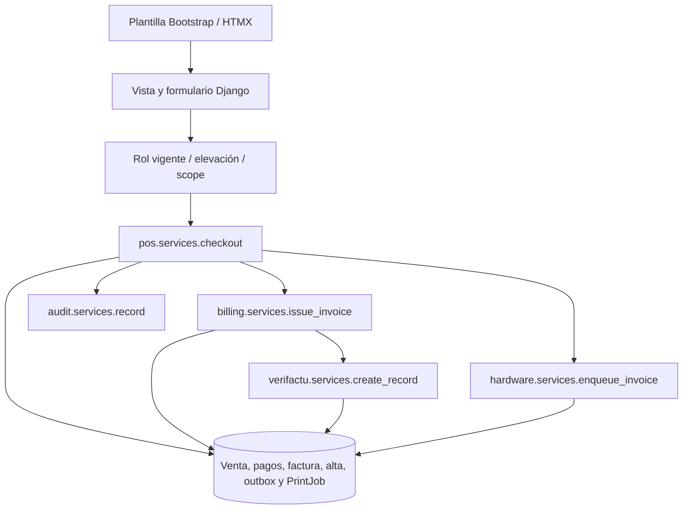

# Arquitectura de BeautyTPV

Descripción del código observado el 15-11-2026. Versión declarada: `0.1.0` en [pyproject.toml](../../pyproject.toml); esta documentación no anuncia una versión estable ni conformidad fiscal. Para comenzar por las operaciones, consulte el [índice de documentación](../README.md).

## Alcance y topología

BeautyTPV es una aplicación Django con páginas renderizadas en servidor, Bootstrap y mejoras HTMX. Cada empresa utiliza una instalación independiente y una SQLite local en el servidor. Los terminales son navegadores HTTP; no acceden al archivo de base de datos. No hay tenants, suscripciones, portal Cliente, agenda ni reservas en V1.

El inicio operativo es el plano `/tpv/`. Los puestos agrupan cuentas persistentes; cobrar formaliza una venta y un documento inmutable. El pago con tarjeta registra la confirmación del datáfono externo: BeautyTPV no es una pasarela bancaria.

El diagrama representa las conexiones previstas por los entrypoints implementados, no un despliegue ya validado en un salón. El proxy, certificados TLS, firewall y autoarranque del equipo de destino requieren instalación y comprobación propias. AEAT y dispositivos físicos conservan los [gates externos](../RELEASE_REPORT.md).

## Estructura y responsabilidades

| Aplicación | Responsabilidad real | Entrada HTTP principal |
|---|---|---|
| `accounts` | Usuario interno, PIN/contraseña, jerarquía, elevación, throttling, revocación y contexto de terminal | `/acceso/`, `/elevar/`, `/salir/` |
| `core` | Empresa singleton, ajustes comerciales/fiscales/TPV, terminales y utilidades transaccionales | `/empresa/` |
| `layout` | Secciones y puestos configurables; protección de puestos con cuentas/historial | `/plano/configuracion/` |
| `catalog` | Servicios/productos, categorías, precio, IVA, orden, actividad y visibilidad | `/catalogo/` |
| `customers` | Ficha comercial, búsqueda, historial y exportación/borrado permitidos | `/clientes/` |
| `pos` | Cuentas, líneas, estados, venta rápida y coordinador de cobro | `/tpv/` |
| `cash` | Cajas, turnos, movimientos, arqueo y cierre | `/caja/` |
| `billing` | Numeración, factura simplificada/completa, rectificativa total, PDF y reimpresión | `/facturas/` |
| `verifactu` | Registro encadenado, XML/QR, outbox, transporte SOAP y respuestas | Consumido por facturación y soporte; comando `send_fiscal` |
| `hardware` | ESC/POS, spool persistente, bridge y agente; control de entrega incierta | `/hardware/` |
| `reports` | Consultas y CSV de operaciones emitidas, caja, métodos, impuestos y devoluciones | `/informes/` |
| `audit` | Eventos protegidos, metadatos permitidos y consulta administrativa | `/auditoria/` |
| `support` | Soporte temporal, diagnóstico, incidencias, dispositivos, backups, mantenimiento y actualizaciones | `/soporte/`, `/usuarios/` |

Las URLs se integran en [config/urls.py](../../config/urls.py). `/usuarios/` se implementa en vistas/formularios de soporte y utiliza servicios de cuentas; no es una quinta clase de usuario. `django.contrib.admin` está instalado como dependencia de Django, pero el proyecto no publica una ruta `/admin/`: la administración documentada es la interfaz propia.

`templates/` contiene la interfaz; `static/vendor/` conserva Bootstrap y HTMX locales. No se exige un CDN para la operativa. `schemas/aeat/` contiene los esquemas y documentación técnica fijados con manifest. `scripts/` reúne instalación, servicio, DEMO, backup, restore, paquetes y auditorías. `tests/` combina servicios, formularios, permisos, procesos SQLite y Chromium. [Modelos](MODELOS_DATOS.md) y [flujos](FLUJOS_NEGOCIO.md) detallan los datos y transiciones.

## Capas y dependencias

La vista valida formularios/parámetros, exige autorización y presenta errores; los servicios ejecutan las reglas de negocio. Los modelos aportan validación y constraints. Las migraciones añaden también triggers SQLite para proteger historia emitida y determinadas intenciones/actuaciones. Ocultar un botón no es una autorización backend.

`checkout` coordina la unidad transaccional. Los imports cruzados de facturación/fiscal/hardware se realizan dentro de funciones cuando es necesario para evitar ciclos de importación. No existe un broker de mensajes externo ni un bus de eventos en memoria como única garantía de entrega: outbox y spool son tablas persistentes.

El importe usa `Decimal`; el precio es IVA incluido, el total de línea se redondea a céntimos con `ROUND_HALF_UP`, y base/cuota se derivan por línea. Los datos de catálogo y empresa que deben permanecer en documentos se copian en snapshots al emitir. La impresión de una copia no vuelve a consultar datos comerciales actuales para reemplazar el emisor histórico.

## Escritura y concurrencia SQLite

[config/settings.py](../../config/settings.py) configura SQLite con `timeout=20` y `transaction_mode="IMMEDIATE"`. El código actual no configura `PRAGMA journal_mode=WAL`; no debe presentarse WAL como una característica activada por defecto. Un único escritor serializa las transacciones de escritura.

La integridad combina:

- Constraints para una cuenta activa por puesto, un turno abierto por caja, una venta por cuenta, clave idempotente única, número fiscal único y original de impresión único.
- Versionado entero y `UPDATE` condicional en cuentas; conflictos visibles sin sobrescribir trabajo ajeno.
- Clave idempotente de cobro y huella persistida de su petición. Repetir la clave con otros datos se rechaza.
- [atomic_retry](../../apps/core/transactions.py): reintenta una unidad completa después del rollback por `locked`/`busy`, hasta cuatro intentos; no reintenta de esa forma una unidad anidada ya dentro de otra transacción.
- Emisión de factura, secuencia, registro fiscal, outbox e intención de impresión dentro de la unidad del cobro. Red e I/O físico se ejecutan después por workers, fuera de esa transacción.

No se usa `select_for_update` como bloqueo de filas SQLite. Nunca compartir `db.sqlite3` por SMB/NFS ni montar una copia de la misma base por terminal. [SQLite](../integraciones/SQLITE.md) explica operación, límites y recuperación.

## Procesos operativos y entrega externa

| Proceso / módulo | Función |
|---|---|
| [scripts/service.py](../../scripts/service.py) | Carga una instancia JSON, sirve WSGI mediante Waitress y supervisa hijos `hardware_worker` y `operations_worker` |
| `hardware_worker` | Reclama trabajos pendientes locales, realiza transporte fuera de atomic y registra resultado; no consume trabajos vinculados a terminal remota |
| `operations_worker` y [scheduler](../../apps/support/scheduler.py) | Ejecutan remisión fiscal y política de backup de forma separada; el fallo fiscal no debe suprimir el backup |
| [hardware/agent.py](../../apps/hardware/agent.py) | Consume trabajos de su terminal por HTTPS/Bearer y mantiene un journal persistente previo al I/O |
| [demo_server.py](../../scripts/demo_server.py) | Waitress loopback con simulador y backups; no ejecuta el trabajador fiscal y bloquea conexiones fuera de loopback |

Los entrypoints oficiales toman un lock compartido del ciclo de vida de la base; restore/update requieren exclusivo. Este lock protege mantenimiento frente a procesos que participan en el contrato, no contra cualquier programa ajeno que abra SQLite por su cuenta. Si muere un worker requerido, el supervisor cierra el servidor para evitar aparentar una operación completa. Los heartbeats y `/health/` muestran mediciones/estado, no prueban aceptación fiscal ni salida de papel.

El transporte fiscal utiliza lease/CAS de outbox y control por endpoint/entorno, incluido `TiempoEsperaEnvio`. La red SOAP ocurre fuera de la transacción corta de reclamación; la respuesta se registra con fencing del lease para no sobrescribir el estado de otro worker. Un timeout nunca autoriza generar otra factura. [VERI*FACTU](../integraciones/VERIFACTU.md) delimita tipos soportados y validación externa pendiente.

El spool distingue `FAILED` anterior al envío de `UNKNOWN` por entrega incierta. Lease vencido o fallo durante I/O no se convierten en éxito ni se reenvían automáticamente. El agente remoto utiliza token de terminal almacenado con hash, nonce de lease y ACK; una cookie de usuario no autentica una máquina. [Hardware](../integraciones/HARDWARE.md) detalla reintentos y comprobaciones físicas pendientes.

## Seguridad y soporte

La jerarquía es `EMPLOYEE < MANAGER < ADMIN < SUPERADMIN`. `require_role` recarga rol/actividad/versión de autenticación desde la base; no se confía en un actor desactualizado. ADMIN/SUPERADMIN requieren elevación para sus vistas administrativas. Cambiar credenciales/rol/actividad o revocar sesiones invalida autenticaciones y concesiones previas.

Superadmin hereda funciones operativas, pero el middleware exige elevación y un scope PII aprobado por otro administrador activo para rutas comerciales sensibles. TECHNICAL, BACKUP y UPDATE autorizan procedimientos diferentes y caducan. Los servicios verifican permisos de actor también cuando se invocan sin HTTP; las entradas HTTP añaden elevación y los scopes correspondientes. [Seguridad](SEGURIDAD.md) y la [matriz de permisos](../ROLE_PERMISSION_MATRIX.md) son la referencia detallada.

## Perfiles de ejecución

| Perfil | Configuración y comportamiento |
|---|---|
| Desarrollo | `config.settings`, DEBUG controlado por entorno; `runserver` solo para desarrollo y pruebas. No utilizar secretos de desarrollo ni HTTP de pruebas como despliegue productivo |
| Instalación local | `scripts/runtime.py` carga JSON externo; `scripts/service.py` usa Waitress. DEBUG desactivado exige secreto externo y HTTPS/cookies seguras; proxy y equipo se validan aparte |
| DEMO Windows | `config.demo_settings`: SQLite/configuración/estáticos/credenciales externos propios, DEBUG falso, localhost8000, TEST fijo, simulador explícito y bloqueo de remisión/conexiones externas |

La DEMO no hereda una SQLite productiva. Tiene cookies de sesión/CSRF con nombres distintos y excepción HTTP solo para loopback; no cambia la configuración productiva. Sus accesos y límites están en [Arranque DEMO](../instalacion/ARRANQUE_DEMO.md).

## Recuperación y evolución

Backups utilizan la API consistente de SQLite y cifrado autenticado. Restore es offline, verifica la copia, conserva evidencia previa y crea retención fiscal/operativa. Debe conciliarse con acuses externos y entregas inciertas antes de reanudar; no basta que la cadena local sea válida.

La actualización valida manifest, rutas, SHA256 y entorno de dependencias antes de escribir; crea backup y ejecuta migrate/check/collectstatic. Ante fallo restaura código, preserva la base vigente y deja hold. No restaura automáticamente una base antigua para hacer rollback de código ni promete rollback del venv.

PostgreSQL es evolución futura, no backend activo V1. La portabilidad del ORM no equivale a portabilidad automática de triggers SQLite. Deben revisarse migraciones, constraints, secuencias, huellas, totales, acuses y colas; véanse [decisiones](DECISIONES_TECNICAS.md) y [procedimiento futuro](../POSTGRESQL_FUTURE.md).

## Evidencia y límites

Fuentes principales: configuración/URLs, servicios de `pos`, `billing`, `verifactu`, `hardware` y `support`, sus migraciones y scripts enlazados. Pruebas relacionadas: `tests/test_concurrency.py`, `test_audit_fiscal.py`, `test_audit_hardware.py`, `test_audit_ops.py`, `test_audit_matrix.py` y pruebas DEMO. Los resultados ejecutados de esta fase se registran en [DOCUMENTATION_AUDIT.md](../DOCUMENTATION_AUDIT.md); cifras de auditorías anteriores son históricas.

La arquitectura local está implementada. Certificado/autorización/acuse oficial AEAT, declaración responsable suscrita, dispositivo real y despliegue/personas del salón siguen sujetos a validación externa. Tampoco se deduce autorización de distribución de la arquitectura: la licencia del producto requiere una decisión explícita del titular.
