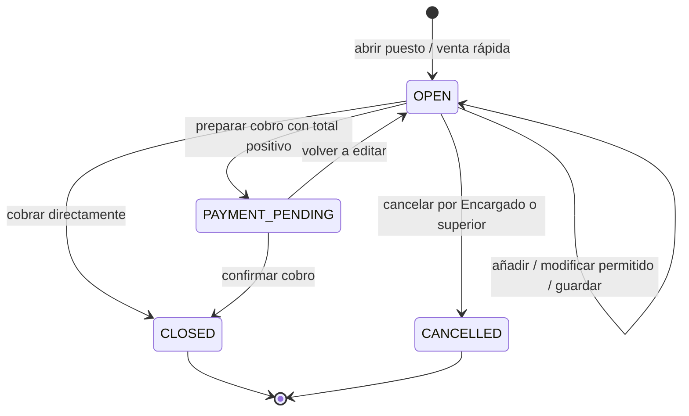
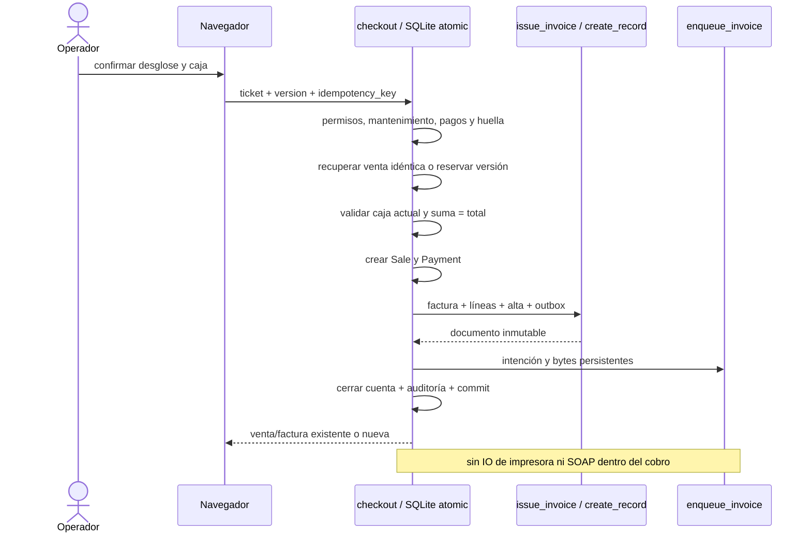

# Flujos de negocio y recuperación

Revisión: 16-11-2026. Describe servicios existentes; no introduce estados, integración bancaria ni automatismos fiscales nuevos. [Modelos](MODELOS_DATOS.md) · [POS](../../apps/pos/services.py) · [Facturación](../../apps/billing/services.py).

## Cuenta por puesto

`open_ticket(station, actor, terminal=None)` recarga un puesto activo y recupera su cuenta OPEN/PAYMENT_PENDING o crea una. Un constraint parcial impide dos activas por puesto. La venta rápida, habilitada expresamente, usa cuenta sin puesto y la reutiliza por usuario/terminal.

Solo OPEN admite edición. Para cancelar una cuenta en cobro, primero se reanuda. No existe traslado gráfico de cuentas: cambiar de pantalla recupera otra cuenta, no la fusiona ni traslada. La cancelación registra actor/fecha; el backfill histórico solo usa auditoría verificable, sin fabricar fechas.

`version` implementa compare-and-swap: `_lock_ticket` hace UPDATE condicional por estado/versión. Conflicto produce TicketConflict y HTTP409. Recargar antes del reintento evita aplicar cambios sobre datos obsoletos.

## Carrito y catálogo

`add_line` recarga artículo/categoría y exige actividad y visibilidad, incluso con POST directo u objeto cacheado. La línea congela descripción/precio/IVA al añadirla. Cantidad positiva con hasta tres decimales y descuento0–100. Añadir descuento requiere Manager; reducir cantidad, modificar descuento o quitar línea también está protegido por servicio.

`set_customer` asocia una ficha, sin crear usuario externo. Volver al plano conserva líneas. Cambios de catálogo no alteran documentos emitidos, que copian los snapshots de las líneas.

## Cobro en una unidad transaccional

La clave idempotente es única en Sale. Se compara SHA256 de la solicitud normalizada: cuenta, componentes, caja y terminal cuando se proporciona. Misma clave/mismos datos recuperan la venta; misma clave/datos distintos se rechaza. Otra clave no permite cerrar otra vez una cuenta ya emitida.

Payment es CASH o CARD; mixto crea componentes. Tarjeta exige referencia de confirmación externa y no llama al banco. Efectivo exige caja abierta/activa y terminal compatible. La caja aumenta por CASH aplicado, no por el recibido: cambio = recibido menos efectivo aplicado. Asociar una sesión a tarjeta no convierte tarjeta en efectivo.

`atomic_retry` repite la unidad completa tras rollback de locked/busy y no reintenta transacción ya anidada. SQLite usa IMMEDIATE y timeout20s; no se confía en bloqueo de fila. Una caída antes del commit revierte venta, numeración, alta y spool; pérdida de respuesta después del commit se resuelve con la misma clave.

## Factura y rectificación

`issue_invoice` reutiliza una factura existente de la venta, aplica guard productivo, reserva número por serie/ejercicio y copia emisor/cliente/líneas. F1/F2 y límite conservador400EUR para simplificada sin datos completos son el escenario del código, no una regla jurídica universal de todos los negocios. Véase [VERI*FACTU](../integraciones/VERIFACTU.md).

Invoice no tiene estado editable «rectificada»: se deriva de relaciones. Una rectificativa es otra Invoice enlazada al original, con importes negativos y Refund. La devolución soportada es **total**, R1/R5, con motivo y método. Efectivo exige sesión abierta/saldo; tarjeta, referencia externa. No se elimina Sale ni se modifica Payment original.

Cambiar nombre/domicilio/series afecta a emisiones futuras. El servicio de ajustes bloquea cambiar NIF/instalación tras emitir. Ticket/PDF leen snapshots históricos, no ajustes actuales.

## Remisión e impresión independientes

| Ciclo | Persistencia y transiciones | Recuperación |
|---|---|---|
| Fiscal | FiscalRecord inmutable; outbox PENDING/RETRY/SENDING y resultado ACCEPTED/ACCEPTED_WITH_ERRORS/REJECTED/DUPLICATE_REVIEW según parser | Lease/token, espera por endpoint y fencing; duplicado no presume aceptación; corrección crea otro registro |
| Impresión | PrintJob PENDING→SENDING→DONE/FAILED/UNKNOWN | FAILED previo al envío puede reintentarse; UNKNOWN/lease vencido exige revisión y copia explícita sin cajón |

Un estado del parser no acredita que haya un acuse real. En DEMO se bloquea `send_one`, no se ejecuta trabajador fiscal y solo se permite simulador. DONE acredita transporte/simulación, no papel físico. [Hardware](../integraciones/HARDWARE.md).

## Caja, informes e incidencias

`open_session` conserva apertura Employee de V1. Movimientos/cierre requieren Manager. Un movimiento exige motivo, importe positivo y saldo para retirada. Cierre guarda esperado, contado, diferencia y actor; no se reescriben movimientos/cierres. Una caja abierta impide desactivar/reasignar su configuración.

Informes consultan snapshots, pagos y devoluciones. Sus filtros seleccionan operaciones completas y desglosan componentes, sin repartos fiscales inventados; CSV neutraliza fórmulas. Superadmin necesita PII independiente en rutas comerciales aunque herede rango operativo.

Incidencias tienen OPEN/IN_PROGRESS/RESOLVED y versión. `add_action` recarga estado/actor, aplica CAS y registra actuación append-only. Manager/Admin solo operativas; Superadmin, elevación HTTP y TECHNICAL en el área técnica. Los patrones rechazan identificadores conocidos, pero no garantizan detectar toda PII: no pegar clientes, claves o XML.

## Mantenimiento y recuperación

`<db>.fiscal-restore-hold` y TechnicalSettings.maintenance bloquean la operativa crítica. La bandera DEMO FISCAL_RESTORE_HOLD es distinta: bloquea remisión fiscal sin inutilizar ventas sintéticas.

La web verifica/prepara restore. Reemplazo real offline exige lock exclusivo, copia previa cifrada y retención; retirar hold requiere conciliación documentada. Update hace preflight, backup y migraciones; ante error revierte código, no automáticamente DB ni historia fiscal. [Procedimientos](../instalacion/BACKUP_RESTORE.md).

## Evidencia

- [E01–E16](../../tests/test_acceptance.py): importes, restricciones y compensación.
- [Procesos](../../tests/test_concurrency.py): persistencia, doble cobro y muerte real antes de commit.
- [Formularios](../../tests/test_audit_forms.py) y [QA independiente](../../tests/test_consolidation_acceptance.py): HTTP/servicio/DB, no solo denegaciones.
- [Chromium](../../tests/e2e/test_browser.py): controles de persona contra persistencia real.
- [Snapshots](../../tests/test_consolidation_documents.py), [fiscal](../../tests/test_audit_fiscal.py) y [hardware](../../tests/test_audit_hardware.py).

El estado vigente y bloqueos están en [auditoría documental](../DOCUMENTATION_AUDIT.md) y [release](../RELEASE_REPORT.md). Los diagramas no sustituyen pruebas ni validación externa.
