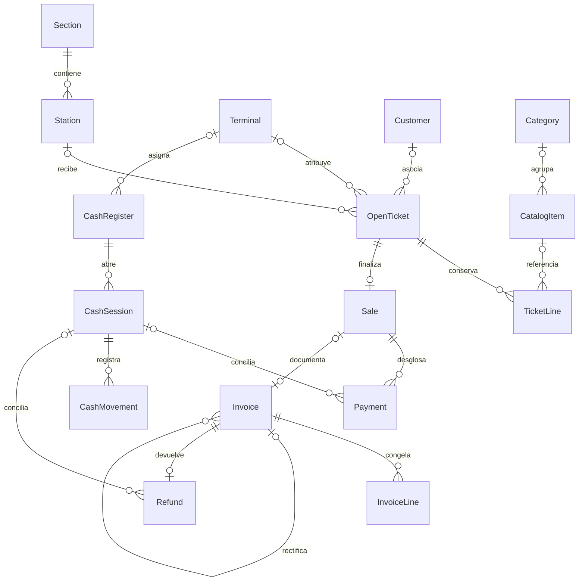
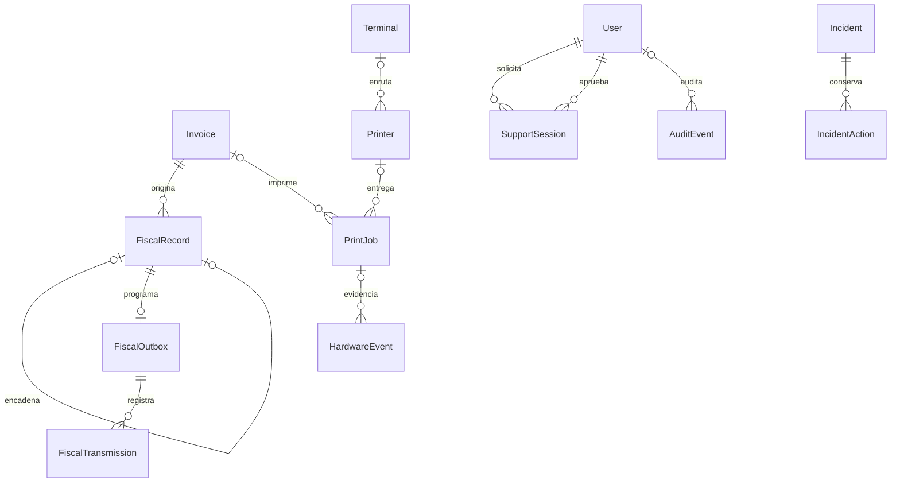

# Modelos de datos

Revisión: 16-11-2026. El ORM declara **35 modelos propios**. No se incluyen las tablas internas de autenticación, sesiones o migraciones de Django. La fuente de verdad son los archivos `models.py` y sus migraciones. [Arquitectura](ARQUITECTURA.md) · [Flujos](FLUJOS_NEGOCIO.md) · [Seguridad](SEGURIDAD.md).

## Catálogo de modelos

| Módulo / fuente | Modelo | Datos y relaciones relevantes | Conservación y controles |
|---|---|---|---|
| [accounts](../../apps/accounts/models.py) | `User` | AbstractUser; cuatro roles, hash PIN, auth_version y activo | Cambiar credenciales/rol/actividad invalida sesiones; Cliente no es rol de acceso |
| accounts | `LoginThrottle` | Clave derivada de usuario/origen, fallos y bloqueo temporal | Estado persistente; no almacenar PIN en claro |
| [audit](../../apps/audit/models.py) | `AuditEvent` | Actor opcional, acción, objetivo, resultado, metadatos y fecha | Append-only en aplicación y triggers SQLite |
| [core](../../apps/core/models.py) | `CompanySettings` | Identidad fiscal, series, preferencias, datos comerciales y PNG del logo | Singleton PK1; servicio impide cambiar NIF/instalación tras emitir |
| core | `Terminal` | Código único, actividad, hash token, presencia y sección/caja preferidas | Preferencias no otorgan permisos |
| [layout](../../apps/layout/models.py) | `Section` | Nombre único y orden | Puestos protegen el borrado |
| layout | `Station` | Código único, nombre, sección, actividad y orden | No desactivar/reasignar con cuenta activa; historial protegido |
| [catalog](../../apps/catalog/models.py) | `Category` | Nombre, orden y visibilidad TPV | Ocultar no borra historia; artículos protegen el borrado |
| catalog | `CatalogItem` | SERVICE/PRODUCT, categoría opcional, precio IVA incluido, impuesto, actividad y orden | Cambios no modifican snapshots emitidos |
| [customers](../../apps/customers/models.py) | `Customer` | Nombre, contacto, datos fiscales y base jurídica | Ficha comercial sin login V1; referencias históricas protegidas |
| [pos](../../apps/pos/models.py) | `OpenTicket` | Puesto/terminal/cliente opcionales, creador, estado, cancelación y versión | Una OPEN/PAYMENT_PENDING por puesto; cancelar, no borrar |
| pos | `TicketLine` | Cuenta, artículo opcional, descripción/precio/IVA, cantidad, descuento y nota | Solo editable con cuenta OPEN; cálculos Decimal |
| pos | `Sale` | OneToOne con cuenta, total, actor, clave idempotente y huella de solicitud | Inmutable; una finalización por cuenta |
| pos | `Payment` | Venta, CASH/CARD, importe, recibido, referencia y caja opcional | Mixto son varios componentes, no un método MIXED; inmutable |
| [cash](../../apps/cash/models.py) | `CashRegister` | Nombre único, actividad y terminal opcional | Configurable; no desactivar/reasignar con turno abierto |
| cash | `CashSession` | Caja, apertura/fondo/actor, cierre, contado, esperado y diferencia | Una abierta por caja; cierre preservado |
| cash | `CashMovement` | Sesión, IN/OUT, importe, motivo, actor y fecha | Append-only; no edición retrospectiva |
| [billing](../../apps/billing/models.py) | `InvoiceSequence` | Serie, ejercicio y siguiente número | Contador único por serie/ejercicio; sin edición web |
| billing | `Invoice` | Venta opcional OneToOne, número, tipo, fecha, emisor/cliente JSON, importes y modo | Inmutable; rectificativa enlaza otra Invoice mediante rectifies |
| billing | `InvoiceLine` | Factura, descripción, cantidad, precio, descuento, IVA y totales | Inmutable y sellada contra inserciones posteriores |
| billing | `Refund` | OneToOne con rectificativa, método, importe, caja opcional, referencia y actor | Devolución total sin modificar Payment original |
| [verifactu](../../apps/verifactu/models.py) | `FiscalRecord` | Factura, tipo, predecesor OneToOne opcional, huella, payload, fecha y XML | Registro inmutable y sucesor único |
| verifactu | `FiscalOutbox` | OneToOne con registro, estado, intentos, próxima ejecución, lease/token y error | Estado de remisión separado del documento |
| verifactu | `FiscalTransmission` | Outbox, fecha, respuesta y estado | Intento append-only; no respuesta oficial inventada |
| verifactu | `FiscalEndpointState` | Entorno único, próxima hora permitida y lease/token | Exclusión y espera persistentes por entorno/endpoint |
| [hardware](../../apps/hardware/models.py) | `Printer` | Transporte, destino, identificadores, encoding, corte, cajón y terminal | Destino no cambia durante SENDING |
| hardware | `PrintJob` | Factura opcional, impresora, tipo, bytes, encoding, cajón, estado, actor y lease | Intención protegida; un original por factura |
| hardware | `HardwareEvent` | Trabajo/impresora opcionales, acción, mensaje y fecha | Append-only; DONE no confirma papel físico |
| [support](../../apps/support/models.py) | `SupportSession` | Actor, aprobador, motivo, alcance, caducidad y revocación | PII exige otro Admin activo; autorización temporal |
| support | `BackupRun` | Archivo, SHA256, creador, fecha y estado | Describe copia cifrada externa; no contiene clave |
| support | `UpdateRun` | Versión, hash paquete, resultado, fecha y nota | Historial; sin retroceso fiscal automático |
| support | `TechnicalSettings` | Política de copias, referencias PEM, entorno y mantenimiento | No guarda bytes de clave privada |
| support | `ServiceHeartbeat` | Nombre único, PID, estado, presencia y error | Telemetría medida; puede mostrar STALE |
| support | `Incident` | Título/descripción, clasificación, prioridad, estado, creador, fechas y versión | Identidad conservada, transiciones y actuaciones |
| support | `IncidentAction` | Incidencia, actor, nota y estados/clasificaciones anterior/nueva | Append-only también mediante SQLite |

## Relaciones comerciales

Cardinalidades resumidas de FK y OneToOne reales. Se omiten enlaces repetidos a User para mantener legibilidad.



`Sale.customer` es una propiedad derivada de la cuenta, no una FK. `Invoice.customer` e `Invoice.issuer` son snapshots JSON. `Terminal.default_register` es una preferencia opcional; no implica tenants ni una segunda instalación.

## Relaciones técnicas



FiscalEndpointState, TechnicalSettings, BackupRun, UpdateRun y ServiceHeartbeat son control operativo: no son padres de facturas ni alteran su identidad.

## Invariantes y migraciones

Tres capas complementarias protegen los datos:

1. Formularios/servicios validan permisos, tipos, actividad actual, límites y transiciones.
2. Constraints de DB: `one_active_ticket_per_station`, `one_open_cash_session`, `invoice_number_unique`, `invoice_sequence_unique`, `one_original_print_per_invoice` y checks de cantidades/importes.
3. Migraciones instalan triggers SQLite para historia de ventas/cobros/cuentas, facturas/líneas, registros fiscales, auditoría, intención de impresión, eventos y actuaciones. Incluyen defensas contra INSERT OR REPLACE cuando corresponde.

No cada regla del servicio tiene un constraint equivalente. `full_clean()` tampoco se ejecuta automáticamente en cualquier `save()`: los servicios lo invocan cuando corresponde. SQL directo y el administrador del SO no son API de negocio. Al portar motor se deben portar/verificar triggers; cambiar ENGINE no conserva por sí solo esas garantías.

Importes Decimal/EUR; `TicketLine` redondea por línea con ROUND_HALF_UP y calcula cuota como total menos base. Django persiste tiempos conscientes de zona/UTC; presentación y fecha fiscal usan zona IANA de empresa. No existe campo dedicado a PAN: no guardar datos completos de tarjeta en referencias ni otros textos.

El recuento se contrastó con `apps.get_models()` sin mutar datos. Para inventario por campo/constraint:

```powershell
.venv\Scripts\python.exe scripts\audit_inventory.py --output docs/phase11/inventory
```

El inventario no acredita funcionalidad por existir un modelo. Evidencia: [concurrencia](../../tests/test_concurrency.py), [regresiones](../../tests/test_regressions.py), [fiscal](../../tests/test_audit_fiscal.py), [configuración](../../tests/test_consolidation_backend.py) y [QA independiente](../../tests/test_consolidation_acceptance.py). Véase [Pruebas](../desarrollo/PRUEBAS.md).
