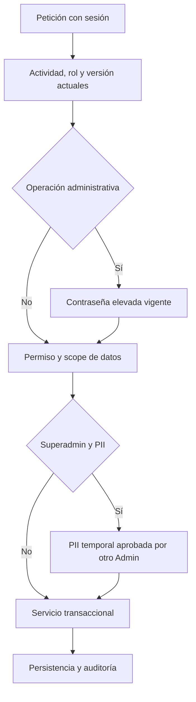

# Seguridad y límites de confianza

Versión de referencia: `0.1.0`, consultada en `pyproject.toml`. Este documento describe controles implementados; no certifica una instalación concreta ni sustituye la revisión jurídica o fiscal. La matriz exhaustiva de operaciones está en [ROLE_PERMISSION_MATRIX](../ROLE_PERMISSION_MATRIX.md).

## Identidad, sesión y autorización

BeautyTPV distingue cuatro roles internos: **Empleado < Encargado < Administrador < Superadmin**. Cliente es una ficha comercial, sin usuario externo ni portal en V1. El rango superior hereda operaciones, pero no elimina elevación, autorización temporal, restricciones documentales ni scopes de datos.

| Capa | Comportamiento real | Fuente y evidencia |
|---|---|---|
| PIN | Entre 6 y 12 dígitos ASCII; hash mediante los hashers Django, nunca texto plano en User | [accounts/models.py](../../apps/accounts/models.py), `test_pin_is_hashed_and_bad_pin_is_rejected` en [test_security.py](../../tests/test_security.py) |
| Contraseña | Validadores Django; perfiles Admin/Superadmin requieren contraseña utilizable al gestionarlos por los servicios | [accounts/services.py](../../apps/accounts/services.py), `create_user`/`update_user` |
| Intentos | Cinco fallos bloquean 15 min; contadores persistidos por hash de usuario y origen. Un origen ya bloqueado no crea filas para cada nombre nuevo | `authenticate_local`, `LoginThrottle`; [test_audit_security.py](../../tests/test_audit_security.py) |
| Elevación | Contraseña verificada concede 10 min. Un nuevo acceso con PIN elimina elevación previa. No cambia el rol | [accounts/views.py](../../apps/accounts/views.py), `elevation_expiry`; pruebas de caducidad y relogin |
| Rango actual | `require_role` consulta actividad, rol y auth_version vigentes en DB, incluso para llamadas de servicio sin request | [accounts/permissions.py](../../apps/accounts/permissions.py), pruebas de actor obsoleto |
| Gestión jerárquica | Admin solo inferiores; Superadmin puede gestionar Superadmins. Se recarga también el destinatario y se impide autodegradación/autodesactivación | `authorize_user_change`/`update_user`; [test_consolidation_security.py](../../tests/test_consolidation_security.py) |
| Revocación | PIN/contraseña/rol/actividad cambian el estado de autenticación; revocar sesiones incrementa auth_version sin cambiar credenciales y revoca concesiones de soporte | `User._get_session_auth_hash`, `revoke_user_sessions`; [test_consolidation_acceptance.py](../../tests/test_consolidation_acceptance.py) |

El PIN es identificación de operación presencial, no un segundo factor. La reautenticación por contraseña es autenticación reforzada; **no se implementa MFA independiente**. La elevación de 10 min no debe confundirse con un timeout de inactividad de toda sesión: la sesión general conserva el mecanismo de Django.

Las vistas protegidas por `role_required` validan rol y exigen elevación automáticamente para mínimos ADMIN/SUPERADMIN. Los servicios que reciben actor comprueban el rango actual. La elevación pertenece a la sesión HTTP y debe exigirse en esa entrada; un actor Python aislado no demuestra posesión de una sesión elevada. Los helpers internos de cálculo/serialización y el ORM directo no constituyen una API pública autorizada.

## Soporte temporal y PII

En `/soporte/`, un Superadmin elevado solicita una autorización con motivo, contraseña del aprobador y alcance. `authorize_support` crea una concesión de 20 min; se comprueba vencimiento, revocación, actividad y rango del aprobador. Los alcances no se suman por herencia:

| Alcance | Uso |
|---|---|
| TECHNICAL | Ajustes técnicos, dispositivos y operaciones técnicas autorizadas |
| PII | Datos comerciales protegidos de clientes/cuentas/facturas/informes |
| BACKUP | Crear, verificar o descargar copias y preparar restauración |
| UPDATE | Comprobar el paquete de actualización desde el panel |

Para PII debe aprobar **otro** Administrador/Superadmin activo. El middleware [SupportPIIMiddleware](../../apps/accounts/middleware.py) protege todos los métodos de clientes, facturas, informes, cuentas y reimpresión técnica, exige elevación y audita concesiones/denegaciones. El alcance técnico no habilita PII. La administración del equipo es una operación interna jerárquica; no requiere crear previamente otro aprobador PII para poder dar de alta al primer Administrador.

Las incidencias operativas están disponibles para Encargado/Admin. Las técnicas requieren Superadmin, elevación HTTP y TECHNICAL. Las notas rechazan patrones identificables de credenciales, XML, correo, tarjetas y otros datos sensibles; **no son un detector universal de información personal**. Se debe describir el problema sin nombres ni identificadores. Véase [support/incidents.py](../../apps/support/incidents.py).

Fuente del flujo: `role_required`, `SupportPIIMiddleware`, `require_authorization` en [support/services.py](../../apps/support/services.py). Las denegaciones no se resuelven ocultando botones: [test_audit_matrix.py](../../tests/test_audit_matrix.py) contrasta rutas, objetos existentes, roles, elevación y CSRF.

## Navegador, red y dispositivos

- Formularios de usuario conservan CSRF; logout es POST. Las cookies de sesión son HttpOnly y SameSite=Lax. En configuración normal con DEBUG=False se activan cookies Secure y redirección HTTPS. Configure hosts y un proxy de confianza que sobrescriba el encabezado de esquema; no active confianza genérica en proxies.
- Producción no utiliza `runserver`. El servidor y SQLite están en la máquina local del negocio; los terminales usan HTTP(S), nunca el archivo SQLite por SMB/NFS.
- La DEMO tiene perfil separado [demo_settings.py](../../config/demo_settings.py): localhost, DEBUG=False, cookies propias y excepción HTTP de loopback, TEST fijo, sin certificados ni remisión. No copie estas excepciones a una instalación real.
- El agente remoto usa token de terminal con hash, estado activo y lease/nonce por trabajo; una cookie o seleccionar una terminal no autentica al agente. Los endpoints de máquina son CSRF-exempt porque usan Bearer, no sesiones de usuario. Véanse [hardware/bridge.py](../../apps/hardware/bridge.py) y [test_audit_hardware.py](../../tests/test_audit_hardware.py).
- Un envío incierto de impresión pasa a UNKNOWN: no se reenvía automáticamente. La copia no abre cajón. No se afirma prueba física por completar el transporte de bytes.

## Datos, auditoría e integridad

La SQLite operativa contiene información comercial en claro para el proceso autorizado: **no hay cifrado integral de la base implementado**. Proteja disco, cuenta de servicio y copias según la política del negocio. No hay campos de PAN/CVV ni integración bancaria: la tarjeta registra una referencia del datáfono externo. No pegue datos de tarjetas en notas o referencias libres; no se promete detección universal de contenido sensible.

`AuditEvent` es append-only por API/ORM y triggers SQLite, incluidos intentos de INSERT OR REPLACE. `record` filtra metadatos por lista permitida, acota valores y valida el formato de SHA256. Los scopes PII registran accesos. Un motivo libre permitido aún puede contener datos indebidos si el operador los introduce: la lista de claves no sustituye minimización y revisión de contenido. Fuentes: [audit/services.py](../../apps/audit/services.py), migraciones de audit y pruebas SQL en [test_audit_security.py](../../tests/test_audit_security.py).

Ventas, cobros, movimientos, documentos emitidos y registros fiscales tienen protección de historial y transiciones/compensaciones válidas. No se ofrece edición fiscal por ser Superadmin. Nombre/contacto de comprobantes se congelan en el snapshot; cambiar ajustes futuros no cambia el original.

Un administrador del SO capaz de sustituir código, esquema o base completa está fuera del aislamiento de roles. Los triggers y la cadena local no autentican por sí solos un historial contra ese adversario. Se requieren control OS, custodia de copias y evidencias externas.

## Secretos y recuperación

No versionar `.env`, configuraciones privadas de instancia, PIN, contraseñas, tokens, certificados/PEM, claves de cifrado, SQLite, backups ni logs de negocio. Los scripts cargan JSON de instancia como datos, no ejecutan configuración como código. Las referencias a certificados/clave son externas; no se guardan sus bytes en DB.

Las copias usan la API consistente de SQLite y cifrado autenticado Fernet con clave externa. Guardar copia y clave juntas reduce su protección. La descarga cifrada sigue siendo una entrega sensible y exige BACKUP. Verificar una copia desde el panel no restaura ni activa mantenimiento.

Restore/update real exige servicio y workers detenidos, lock exclusivo y procedimiento CLI; la web prepara/verifica. Restore conserva copia previa y activa retención fiscal hasta conciliación documentada. Rollback de código no retrocede automáticamente la base ni elimina documentos. Véanse [guía de operaciones](../instalacion/BACKUP_RESTORE.md) y [actualizaciones](../instalacion/ACTUALIZACIONES.md).

## Amenazas y límites verificables

| Amenaza | Control implementado | Verificación / límite |
|---|---|---|
| Fuerza bruta de PIN | Hash y throttle persistente usuario/origen | Pruebas de bloqueo; no sustituye seguridad del puesto físico |
| Sesión o actor obsoleto | HMAC de seguridad y auth_version; recarga de DB | Pruebas de reset, degradación y revocación |
| Escalada de Administrador | Rango actual del actor y destinatario | Pruebas contra pares y Superadmin |
| Soporte indiscriminado | Elevación, motivo, scopes, aprobación independiente PII | Pruebas GET/POST y concesiones revocadas |
| Manipulación del historial | Servicios, constraints y triggers | Pruebas ORM/SQL; no protege frente a sustitución por admin OS |
| Exposición de copia | Cifrado, clave externa y scope BACKUP | Recuperación aislada probada; custodia destino pendiente del operador |
| Red/dispositivo caído | Outbox/spool persistente y estados explícitos | AEAT con certificado y hardware físico siguen pendientes |

Para comunicar una vulnerabilidad siga [SECURITY.md](../../SECURITY.md). Las pruebas locales y el inventario de dependencias no constituyen certificación de seguridad, cumplimiento RGPD ni homologación AEAT. Los gates externos se mantienen en [RELEASE_REPORT](../RELEASE_REPORT.md).

## Contraste de esta documentación

Revisión del 15-11-2026 contra modelos, servicios, middleware y configuración reales. Se ejecutó `python -m pytest -q tests/test_security.py tests/test_audit_security.py tests/test_consolidation_security.py`: **120 PASS, 36,48 s**. Incluye rangos, actores/destinatarios obsoletos, revocación, elevación, PII, CSRF y protección SQL de auditoría. No se modificó comportamiento funcional para documentarlo. La regresión completa y el enlace final de documentos corresponden al cierre independiente de [DOCUMENTATION_AUDIT](../DOCUMENTATION_AUDIT.md).
