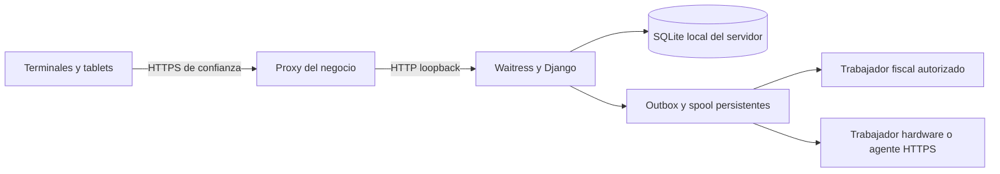

# Despliegue local de una instalación real

**Objetivo:** servir BeautyTPV a los terminales de una empresa desde su propio servidor, con SQLite exclusivamente en disco local. La preparación del software no aprueba fiscalidad productiva ni verifica el equipo de destino.

## Topología y límites



El proxy, su certificado y el registro del servicio en el sistema operativo son tareas del instalador del negocio: el repositorio no configura IIS/Nginx/Caddy, firewall, DNS ni autoarranque automáticamente. Los terminales acceden por navegador, nunca abriendo el fichero SQLite ni un recurso SMB/NFS.

## Preparación y permisos

**Previos:** [instancia instalada](INSTALACION_WINDOWS.md), responsable técnico, acceso OS autorizado y copia recuperable. Mantenga el entorno fiscal TEST mientras existan [bloqueos externos](../integraciones/VERIFACTU.md).

1. Asigne una cuenta de servicio de Windows con los permisos mínimos para código, directorio de instancia, copias y dispositivos necesarios. No use una cuenta compartida de operador como servicio sin analizar custodia de secretos y recuperación.
2. Proteja `instance.json`, claves de backup y PEM externos mediante ACL. Los roles de la aplicación no aíslan a un administrador del sistema capaz de sustituir código o SQLite.
3. Compruebe que `BEAUTYTPV_DEBUG` es `0`, `BEAUTYTPV_DB` apunta a la base de esa empresa y `BEAUTYTPV_ALLOWED_HOSTS` contiene el nombre real usado por el navegador. No use un host comodín para resolver errores de configuración.
4. Configure el proxy con HTTPS y un certificado que los terminales confíen. Sobrescriba, no reenvíe ciegamente, el encabezado de esquema del cliente.
5. Si el proxy de confianza está en loopback, habilite en el JSON de instancia las claves existentes:

   ```json
   {
     "BEAUTYTPV_TRUST_PROXY": "1",
     "BEAUTYTPV_CSRF_TRUSTED_ORIGINS": "https://tpv.salon.example",
     "BEAUTYTPV_ALLOWED_HOSTS": "tpv.salon.example,localhost,127.0.0.1"
   }
   ```

   Es un fragmento ilustrativo, **no** un `instance.json` completo. El dominio `.example` se sustituye por el autorizado del negocio. Conserve los secretos externos existentes y las demás claves.

## Iniciar el servicio de aplicación

Desde la raíz del código, en el contexto de la cuenta elegida:

```powershell
$env:DJANGO_SETTINGS_MODULE = "config.settings"
powershell.exe -NoProfile -File scripts\start.ps1 -Instance "C:\BeautyTPV\instancia\instance.json" -HostName "127.0.0.1" -Port 8000
```

No añada `-Development` en despliegue real. Ese switch habilita DEBUG para pruebas. No sustituya el servicio por `manage.py runserver`.

`scripts/service.py` crea Waitress, levanta `hardware_worker` y `operations_worker` y supervisa sus procesos. Si un hijo requerido termina, cierra la web para evitar operativa parcialmente sana. El ciclo de operaciones puede intentar remitir la outbox del entorno configurado: TEST no significa offline. Para una demostración sin red use [el perfil DEMO](ARRANQUE_DEMO.md), que no inicia ese trabajador fiscal.

El comando anterior es un proceso en primer plano. Para operación habitual sin terminal, el técnico debe integrarlo en el gestor de servicio/tareas adoptado por su organización, registrar el mecanismo concreto de parada y probar reinicio de Windows. No se afirma que esta integración OS ya exista. No use los accesos **Detener DEMO** para parar una instancia comercial.

## Validar antes de ofrecer acceso

1. Ejecute las comprobaciones de instancia:

   ```powershell
   $env:DJANGO_SETTINGS_MODULE = "config.settings"
   powershell.exe -NoProfile -File scripts\check.ps1 -Instance "C:\BeautyTPV\instancia\instance.json"
   ```

2. Acceda por la URL HTTPS real y compruebe estáticos, cookies de sesión, CSRF y ausencia de errores de proxy. `/health/` informa DB y supervisión sin revelar credenciales; no sustituye un recorrido de venta ni valida AEAT.
3. Con cada rol revise elevación, permisos y scopes. Superadmin consulta salud/versiones/colas en `/soporte/`, con autorizaciones adicionales para acciones sensibles.
4. Pruebe generación de copia cifrada, descarga autorizada y restauración en un destino aislado. Registre custodia de la clave por separado.
5. Configure y pruebe las impresoras/agentes según [HARDWARE](../integraciones/HARDWARE.md), incluyendo conexión, firmware y entrega incierta.
6. Complete la validación fiscal oficial y declaración responsable antes de tramitar el desbloqueo productivo. No cambie el guard para eludir este gate.

**Resultado esperado:** servicio y trabajadores supervisados, navegación por HTTPS sin exposición directa de SQLite y una recuperación demostrada. TLS/firewall/LAN, pruebas físicas y aceptación por personal del salón siguen requiriendo evidencia del equipo concreto.

## Mantenimiento y parada

La pantalla de mantenimiento puede bloquear nuevas mutaciones operativas, pero no para procesos ni concede un lock exclusivo de restauración. Para [restore](BACKUP_RESTORE.md) o [update](ACTUALIZACIONES.md), cierre terminales, detenga servicio, trabajadores y bridges por sus mecanismos registrados y compruebe que la operación obtiene el lock exclusivo. No mate todos los Python del equipo ni retire un hold fiscal para forzar el arranque.

Fuentes: `scripts/service.py`, `scripts/start.ps1`, `scripts/runtime.py`, `config/settings.py`, `apps/support/operations.py` y pruebas `test_audit_ops.py`. Estado verificable y límites: [DOCUMENTATION_AUDIT](../DOCUMENTATION_AUDIT.md).
