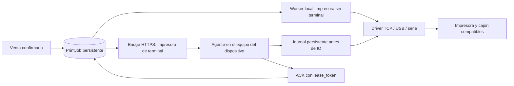
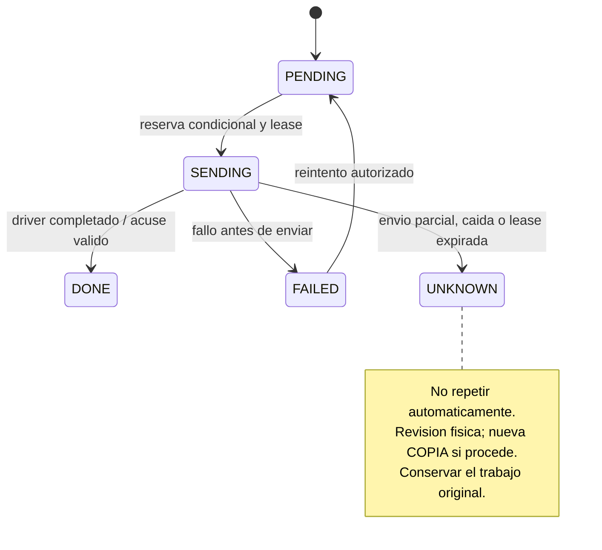

# Impresión ESC/POS, cajón y terminales

Versión documental: BeautyTPV `0.1.0`, código existente revisado el 15-11-2026. Este documento describe la implementación y sus límites. **No hay una marca, modelo o firmware de impresora/cajón certificado mediante pruebas físicas en este repositorio.** La DEMO usa un simulador identificado, no una impresora real.

## Estado y alcance

| Capacidad | Estado | Evidencia y límite |
|---|---|---|
| Render de ticket, QR, corte y pulso de cajón | Implementado y verificado localmente | [Generador ESC/POS](../../apps/hardware/escpos.py), [tests](../../tests/test_hardware.py); no acredita papel ni lectura óptica |
| Transporte TCP | Implementado; loopback verificado | `test_tcp_loopback_transmits_exact_bytes_without_physical_device` en [auditoría](../../tests/test_audit_hardware.py); no impresora física |
| Transporte USB y serie | Implementado; dispositivo pendiente | [Drivers](../../apps/hardware/drivers.py); librerías/controladores y equipo de destino por validar |
| Cola persistente, copias, leases y entrega incierta | Implementado y verificado localmente | [Servicios](../../apps/hardware/services.py), [tests de auditoría](../../tests/test_audit_hardware.py) |
| Bridge HTTPS por terminal y agente con journal | Implementado y verificado con transporte de prueba | [Bridge](../../apps/hardware/bridge.py), [agente](../../apps/hardware/agent.py); TLS/autoarranque en terminal real pendientes |
| Simulador DEMO | Verificado en ejecución local | [Evidencia Windows](../evidence/windows-demo-browser.json); `DONE` simulado, cero hardware físico |
| Legibilidad80mm, QR impreso, corte y apertura de cajón | **BLOQUEADO EXTERNO** | Requiere dispositivos y checklist físico al final |

El driver puede terminar de escribir bytes sin saber si había papel, si se cortó o si abrió el cajón. **`DONE` significa entrega al transporte —o consumo simulado—, nunca confirmación física.**

## Componentes y topologías reales



SQLite reside exclusivamente en el servidor. El agente remoto obtiene una intención ya generada por HTTPS; no abre ni comparte el fichero SQLite por SMB/NFS. Una impresora Ethernet puede alcanzarse desde el servidor local sin agente remoto, si la red y los permisos lo permiten.

El cobro encola el original dentro de su unidad transaccional; la escritura al dispositivo ocurre después, fuera de la transacción financiera. Un fallo de impresora no obliga a repetir cobro, número fiscal ni factura. La restricción de base de datos permite un único original `RECEIPT` por factura; las copias son trabajos nuevos identificados `COPY`.

### Selección del dispositivo

1. Se toma la terminal persistida en la cuenta al cobrar.
2. Si tiene impresoras habilitadas asociadas, se elige la primera por clave primaria.
3. Si no hay una, se busca la primera habilitada con terminal vacía: fallback local explícito.
4. Si no hay dispositivo válido, la intención permanece pendiente y se muestra incidencia; la venta conserva su factura.

El worker central solo consume trabajos de impresoras **sin terminal**. Los de una terminal asociada corresponden al agente de esa terminal. La preferencia de caja/sección de una terminal no autentica al agente: este necesita su token independiente.

## Configurar una impresora desde Superadmin

**Objetivo:** registrar un destino conocido sin alterar trabajos históricos.

**Requisitos:** Superadmin con contraseña elevada; autorización temporal `TECHNICAL`; impresora y conexión identificadas por el técnico. La DEMO solo permite `SIMULATOR`.

1. Entre en **Soporte técnico** y autorice una sesión de alcance Técnico.
2. Abra la configuración de dispositivos o edite una impresora existente.
3. Complete los campos de la tabla y guarde.
4. Solicite un ticket de prueba autorizado. Compruebe la cola y, cuando exista dispositivo real, el resultado físico.

| Control | Significado y validación real |
|---|---|
| Nombre | Identificador único del dispositivo |
| Tipo | `TCP`, `USB`, `SERIAL` o `SIMULATOR` |
| Terminal | Vacío para worker/fallback local; terminal concreta para el agente remoto |
| Dirección | Host/IP para TCP; puerto local, por ejemplo `COM3`, para serie |
| Puerto | TCP entre1 y65535; en serie representa velocidad, con opciones1200/2400/4800/9600/19200/38400/57600/115200 en formulario |
| USB vendor/product | VID/PID numéricos entre1 y65535; obtenerlos del dispositivo/controlador real |
| USB endpoint | Endpoint de salida entre1 y255; no adivinarlo |
| Encoding | Lista admitida por el modelo: ASCII, CP437, CP850, CP858, CP1252, Latin1 o UTF8; la selección debe corresponder al dispositivo |
| Codepage | Número ESC/POS0–255; el predeterminado19 acompaña CP858, pero la tabla del fabricante debe comprobarse |
| Habilitada | Permite seleccionar/consumir nuevos trabajos; desactivar no borra historial |
| Cortar papel | Incluye corte en bytes de trabajos nuevos |
| Cajón habilitado | Permite solicitar pulso conforme a la política; deshabilitarlo impide también su prueba técnica |

**Resultado esperado:** configuración validada, auditada y disponible en su topología. Si hay un trabajo `SENDING`, cambiar conexión, destino o terminal se rechaza hasta resolver la entrega. Cambiar corte/cajón/codificación no reescribe payloads ya persistidos.

**Errores habituales:** USB no detectado o sin permisos; puerto COM ocupado; dirección vacía; codificación no admitida; cambio de destino durante envío. Corrija la configuración, no la factura. Las bibliotecas Python no sustituyen el controlador/libusb requerido por un dispositivo USB concreto.

## Ejecución local del bridge

Los ejemplos se ejecutan desde la raíz y dentro del entorno instalado. Para la instancia normal, cargue primero su configuración externa como se explica en [despliegue local](../instalacion/DESPLIEGUE_LOCAL.md). Un `manage.py` sin esa configuración no selecciona por sí solo la instancia del salón.

```powershell
.venv\Scripts\python.exe manage.py hardware_worker --once
```

`--once` procesa una tanda; sin él, el worker continúa con su intervalo. El servicio normal de [scripts/service.py](../../scripts/service.py) arranca y supervisa este trabajador. No cree un segundo servicio redundante sin un procedimiento operativo deliberado. Use una cuenta OS limitada con acceso al dispositivo y a la instancia; no el Django de desarrollo como servicio productivo.

Existe además un bridge de activación HTTP **solo loopback**:

```powershell
.venv\Scripts\python.exe manage.py hardware_bridge --port 8766
```

Necesita `BEAUTYTPV_BRIDGE_TOKEN` aleatorio de al menos32 caracteres, externo al repositorio. Acepta `POST /jobs/<id>` con Bearer y cuerpo vacío para procesar un trabajo existente; no admite bytes, direcciones ni comandos aportados por HTTP. No se expone directamente a LAN y no reemplaza el protocolo remoto por terminal.

## Agente remoto por terminal

**Objetivo:** imprimir en un equipo de terminal sin compartir SQLite.

**Requisitos:** terminal activa, impresora asociada, endpoint HTTPS de confianza, token del bridge de esa terminal, journal en disco persistente con ACL restringida y dependencias/controladores instalados. El servidor guarda el hash del token; el agente necesita el valor original protegido fuera del repositorio.

1. Configure la terminal en **Soporte → Terminales y bridge** y asigne un token aleatorio de32–256 caracteres.
2. Asocie su impresora a esa terminal y selecciónela al acceder al TPV.
3. En el equipo agente, configure las variables del ejemplo y adapte el nombre HTTPS y el ID real. El módulo requiere settings Django incluso para transportar bytes; no necesita ni debe recibir acceso al SQLite del servidor.
4. Ejecute el agente. Configure y verifique su autoarranque mediante el procedimiento del sistema de destino; no se declara instalado automáticamente por este comando.

```powershell
$env:DJANGO_SETTINGS_MODULE = 'config.settings'
$env:BEAUTYTPV_DEBUG = '0'
# Secreto local efimero para cargar settings, distinto del secreto del salon.
$env:BEAUTYTPV_SECRET_KEY = & .venv\Scripts\python.exe -c "import secrets; print(secrets.token_urlsafe(64))"
$token = Read-Host 'Token privado de esta terminal' -AsSecureString
$env:BEAUTYTPV_TERMINAL_TOKEN = [System.Net.NetworkCredential]::new('', $token).Password
.venv\Scripts\python.exe -m apps.hardware.agent --server https://tpv.nombre-local --terminal 1 --journal C:/BeautyTPV/agent-journal.json
```

El secreto local recién generado permite cargar la configuración con DEBUG falso; **no** es una credencial de acceso al servidor, ni se debe reutilizar el secreto del negocio. El token de terminal sí autentica el protocolo. No imprima las variables, ni guarde sus valores en capturas/logs. El comando HTTPS es un ejemplo de estructura: sustituya host/ID por la instalación real y verifique su CA. `--development-loopback` permite HTTP únicamente en localhost explícito; no permite HTTP remoto. `--once` ejecuta un ciclo y sale. El agente rechaza `SIMULATOR` deliberadamente; la DEMO utiliza su trabajador local.

### Claim, journal y acuse

| Etapa | Comportamiento |
|---|---|
| Claim | `POST /hardware/bridge/<terminal>/claim/`, Bearer de terminal activa; solo su cola habilitada |
| Reserva | Cambio condicional `PENDING→SENDING`, intento y lease_token; lease remoto de dos minutos |
| Antes de IO | El agente persiste journal con servidor, terminal, trabajo y nonce antes de enviar bytes |
| Entrega | El driver clasifica éxito, fallo previo o incertidumbre; el agente persiste ese resultado |
| ACK | `POST /hardware/bridge/<terminal>/jobs/<job>/ack/` con token y nonce; acuse repetido idéntico es idempotente |
| Caída/red perdida | Con journal existente se reintenta el acuse, no los bytes; sin resultado persistido se considera `UNKNOWN` |

Una lease expirada no autoriza a otro agente a repetir la entrega. El bridge devuelve conflicto o pone la intención en `UNKNOWN`; un nonce incorrecto o de otra terminal se rechaza. Una cookie del navegador no autentica este protocolo. Las rutas de máquina están exentas de CSRF porque exigen Bearer, no porque sean públicas.

## Estados y recuperación segura



| Situación | Acción permitida | Resultado esperado |
|---|---|---|
| `PENDING` sin impresora | Superadmin elevado+Técnico asigna dispositivo válido y solicita reintento | Misma intención lista; no otro cobro/factura |
| `FAILED` previo al envío | Revisar conexión/configuración y reintentar bajo autorización | Vuelve a pendiente; driver hace una nueva tentativa |
| Nuevo dispositivo con encoding/codepage distintos | Solicitar copia adecuada, no alterar bytes del original | Se rechaza reintento incompatible |
| `SENDING` | Esperar resultado o expiración; no cambiar destino | No carreras de configuración durante IO |
| `UNKNOWN` | Revisar físicamente lo ocurrido; si procede generar una copia identificada | La copia es otro trabajo y no pulsa cajón |
| `DONE` pero no sale papel | Revisar físicamente; no asumir que un reenvío es seguro | Conservar evidencia y usar copia controlada cuando corresponda |
| Restore/mantenimiento retenido | Seguir conciliación documentada antes de reanudar | No saltarse el hold ni reenviar trabajos históricos a ciegas |

**Nunca repita el cobro para recuperar una impresión.** No edite/elimine filas de la cola ni su auditoría para ocultar la incidencia. El usuario Empleado puede solicitar copias de sus propias facturas; el backend restringe documentos ajenos. Pruebas de ticket/cajón y recuperación de trabajos requieren Superadmin elevado y autorización `TECHNICAL` en HTTP. Los servicios también comprueban el rol persistido. El acceso comercial del Superadmin a facturas exige además el scope PII existente; consulte [seguridad](../arquitectura/SEGURIDAD.md).

## Tickets, cajón y límites visuales

- Comandos generados: inicialización ESC/POS, selección de página, QR nativo, corte opcional y pulso `ESC p` en el pin codificado por el generador. No hay configurador de pines/pulsos arbitrarios en la interfaz: confirmar compatibilidad en el manual del fabricante antes de conectar el cajón.
- Pulso automático solo si hay componente CASH positivo y la impresora tiene cajón habilitado. Un pago solo tarjeta no abre. Una copia nunca abre; una prueba de cajón es una acción técnica separada y auditada.
- Texto de usuario se sanea para evitar inyectar controles ESC/POS; encoding usa lista cerrada. Esto no garantiza que todos los glifos existan en la tabla del dispositivo.
- Nombre comercial, contacto, dirección y pie proceden de `Invoice.issuer`, congelado al emitir. Reimprimir o rectificar no lee valores actuales para reescribir esos datos.
- El logotipo configurado es de la interfaz. No se promete impresión raster ESC/POS del logo en V1. El PDF y su impresión desde navegador no sustituyen la integración de impresora/cajón por bridge.

## Checklist físico pendiente

**Objetivo:** cerrar la validación externa por combinación de dispositivo y controlador, no declarar compatibilidad universal.

**Precondiciones:** entorno de pruebas aislado, operador autorizado, papel80mm/cajón compatibles, configuración verificada contra el fabricante y sin datos personales reales.

1. Registrar fecha, operador, marca, modelo, firmware, sistema operativo, driver/libusb, conexión, VID/PID/endpoint o host/puerto, codepage y cajón/pin compatibles.
2. Imprimir servicio/producto, acentos, euro, importes, IVA y texto largo. Verificar ancho, legibilidad y corte real.
3. Leer el QR impreso con lector independiente y contrastar el contenido con la factura TEST; no atribuir aceptación AEAT a esa lectura.
4. Cobrar efectivo y comprobar una sola apertura; tarjeta y copia no deben abrir. Probar la política de cajón deshabilitado.
5. Desconectar antes del envío y recuperar `FAILED`; interrumpir durante envío/reiniciar agente y conciliar `UNKNOWN` sin doble papel/pulso automático.
6. Comprobar reinicio, journal, ACK perdido y permisos mínimos del servicio en el terminal real.
7. Adjuntar evidencias saneadas y resultado de cada punto al reporte del instalador. Un fallo deja esa combinación pendiente.

**Resultado actual: BLOQUEADO EXTERNO.** No se han probado en esta fase impresora, lector QR, cajón ni autoarranque físico en otro Windows10/11. Las evidencias de software no sustituyen esa aceptación.

## Trazabilidad y comprobaciones documentales

| Fuente real | Qué permite contrastar |
|---|---|
| [Modelo y validación](../../apps/hardware/models.py) | Campos, destinos durante SENDING, original único e intención inmutable |
| [Servicios](../../apps/hardware/services.py) | Selección de impresora, copias, leases locales de60s, retry y eventos |
| [Vistas](../../apps/hardware/views.py) y [rutas](../../apps/hardware/urls.py) | Autorización HTTP, copia, prueba y reintento |
| [Formulario técnico](../../apps/support/forms.py) | Controles de dispositivo y simulador |
| [Tests iniciales](../../tests/test_hardware.py) | Cajón, copia, fallos previos/parciales, simulador y saneado |
| [Auditoría de hardware](../../tests/test_audit_hardware.py) | TCP loopback exacto, scopes, lease, claim/ACK/journal y SQL REPLACE |
| [Consolidación](../../tests/test_consolidation_hardware.py) | Corte/cajón, configuración auditada y objetos obsoletos |
| [Perfil DEMO](../../tests/test_demo_profile.py) | Simulación explícita con DEBUG falso y rechazo de drivers físicos |

En esta fase documental se ejecutaron `apps.hardware.agent --help` y `manage.py hardware_worker --help`: EXIT0, sin envío. Se reprodujo que el agente sin `DJANGO_SETTINGS_MODULE` falla al acceder al driver; con el módulo y secreto local del procedimiento anterior se comprobó `DriverUnavailable` ante una conexión **interceptada de prueba**, con cero IO real. Esta comprobación no se presenta como una sesión remota, TLS ni impresión física. La suite general y su fecha efectiva se registran en la [auditoría documental](../DOCUMENTATION_AUDIT.md).
