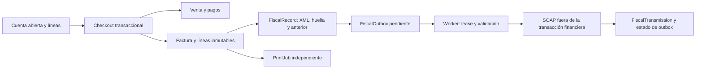

# Facturación y VERI*FACTU

Estado de la integración documentada: **implementada y verificada localmente para el escenario indicado; validación oficial y puesta en producción BLOQUEADAS EXTERNAMENTE**. Revisión de fuentes y código: 15-11-2026. Versión del proyecto en `pyproject.toml`: `0.1.0`; no se declara un lanzamiento fiscal estable.

BeautyTPV genera facturas, sus registros encadenados y una cola persistente. Un documento TEST, un XML válido o un test aprobado no acreditan una remisión aceptada ni la conformidad global de una instalación. El [informe de release](../RELEASE_REPORT.md) conserva los gates pendientes.

## Alcance realmente implementado

| Función | Comportamiento actual | Estado / límite |
|---|---|---|
| Impuestos | Desglose de IVA por tipo; XML con impuesto `01`, régimen `01` y calificación `S1` | Verificado localmente; solo ese escenario fiscal |
| Facturas | F2 simplificada y F1 completa; series configurables distintas, ejercicio y contador transaccional | F1 se selecciona cuando la ficha aporta NIF y domicilio; sin esos datos el código rechaza importes superiores a 400 EUR. Es un límite conservador del producto, no una explicación general de todos los supuestos legales |
| Devolución posterior a emitir | Rectificativa **total** R5 de F2 o R1 de F1, por diferencias (`TipoRectificativa=I`), referencia al original y `Refund` conciliado | No hay devoluciones parciales. La adecuación de R1 y del motivo al supuesto real requiere revisión fiscal |
| Registros | Alta, anulación registral y nuevos registros de subsanación, conservando el origen | Anular un registro no devuelve dinero ni cancela contablemente una venta |
| Documentos | PDF y ticket térmico con snapshots, importes, desglose, identificación y QR; las copias se identifican | QR/PDF y bytes térmicos probados localmente; papel y lectura óptica física pendientes |
| Transporte | SOAP por entorno, certificado cliente y clave PEM externos, validación TLS y respuestas persistidas | Preparado; sin certificado/autorización ni acuses oficiales en esta entrega |
| Otros escenarios | Exenciones, inversión de sujeto pasivo, regímenes especiales, IGIC/IPSI, representación y modalidad no VERI*FACTU | No implementados ni anunciados como soportados |

El catálogo permite configurar tipos de IVA, pero no determina por sí mismo el régimen jurídico aplicable. No active una empresa cuyo régimen quede fuera del escenario implementado. La facturación electrónica B2B general tampoco se presenta como una función implementada por esta integración.

## Marco oficial y fuentes de verdad

El marco revisado comprende el artículo 29.2.j de la Ley General Tributaria, el reglamento aprobado por el Real Decreto 1007/2023 y su desarrollo técnico por la Orden HAC/1177/2024. El texto consolidado del real decreto consultado incorpora modificaciones posteriores; la elección del ámbito, las exclusiones y los plazos de cada obligado debe revisarse con sus textos oficiales antes de desplegar. Este manual no fija una fecha universal de obligación. Fuentes: [RD 1007/2023 en BOE](https://www.boe.es/buscar/act.php?id=BOE-A-2023-24840), [Orden HAC/1177/2024 en BOE](https://www.boe.es/buscar/act.php?id=BOE-A-2024-22138), [RD 254/2025](https://www.boe.es/eli/es/rd/2025/04/01/254) y [RDL 15/2025](https://www.boe.es/eli/es/rdl/2025/12/02/15).

La declaración responsable corresponde al productor del sistema: probar el programa no sustituye su identificación, revisión, firma y publicación. Véase la [FAQ oficial sobre declaración responsable](https://sede.agenciatributaria.gob.es/Sede/iva/sistemas-informaticos-facturacion-verifactu/preguntas-frecuentes/certificacion-sistemas-informaticos-declaracion-responsable.html). El [borrador del repositorio](../DECLARACION_RESPONSABLE_TEMPLATE.md) está sin suscribir; no es una declaración expedida ni una homologación de AEAT.

Para actualizar el protocolo se parte de la [información técnica de AEAT](https://sede.agenciatributaria.gob.es/Sede/iva/sistemas-informaticos-facturacion-verifactu/informacion-tecnica.html), en particular sus apartados de [servicio y validaciones](https://sede.agenciatributaria.gob.es/Sede/iva/sistemas-informaticos-facturacion-verifactu/informacion-tecnica/especificaciones-servicios-remision-voluntaria-registros-validaciones.html), [huella](https://sede.agenciatributaria.gob.es/Sede/iva/sistemas-informaticos-facturacion-verifactu/informacion-tecnica/algoritmo-calculo-codificacion-huella-hash.html), [QR](https://sede.agenciatributaria.gob.es/Sede/iva/sistemas-informaticos-facturacion-verifactu/informacion-tecnica/caracteristicas-qr-especificaciones-servicio-cotejo-factura.html) y [ejemplos de declaración](https://sede.agenciatributaria.gob.es/Sede/iva/sistemas-informaticos-facturacion-verifactu/informacion-tecnica/ejemplo-declaracion-responsable.html). La documentación de otro programa no reemplaza estas fuentes.

## Factura, registro y estado de envío son objetos distintos



[`checkout`](../../apps/pos/services.py) formaliza la venta. [`issue_invoice`](../../apps/billing/services.py) reserva serie/ejercicio/número y crea snapshots. [`create_record`](../../apps/verifactu/services.py) crea el registro y su outbox dentro de esa unidad de trabajo. Una caída antes del commit revierte la unidad; el reintento idempotente no duplica cobro ni numeración. La red y la impresión física no se ejecutan dentro de esa transacción financiera.

`Invoice.issuer`, `Invoice.customer` e `InvoiceLine` fijan los datos emitidos. Nombre comercial, contacto y pie de comprobantes también quedan congelados: reimprimir o rectificar no los sustituye por los ajustes actuales. Cambios posteriores de catálogo no reescriben líneas. El servicio de configuración impide reasignar NIF e identificador de instalación tras emitir.

Los managers/modelos y triggers SQLite protegen documentos, registros y transmisiones frente a cambios, eliminación y reemplazo SQL. El estado operativo mutable vive en `FiscalOutbox`; no se cambia el documento para reflejar una respuesta. Estos controles no aíslan el archivo frente a un administrador del sistema operativo: se mantienen permisos de disco, backups y evidencias externas.

## XML, huella y cadena

Los artefactos oficiales fijados están en [`schemas/aeat`](../../schemas/aeat/manifest.json). El manifiesto indica URL y SHA256; `.gitattributes` conserva sus bytes sin conversión de finales de línea. El parser resuelve las dependencias XSD localmente, desactiva entidades externas y acceso de red. `build_xml`, `validate_xml`, `soap_envelope`, `validate_response` y `verify_record_snapshot` están en [`protocol.py`](../../apps/verifactu/protocol.py).

`canonical_hash` construye una cadena UTF-8 en orden fijo y calcula SHA256 hexadecimal en mayúsculas. Para alta incluye identidad del emisor, número, fecha, tipo, cuota, total, huella anterior y fecha/hora con huso; la anulación usa el conjunto específico de identidad anulada, huella anterior y fecha/hora. No se hashea un JSON arbitrario ni el XML completo como sustituto del algoritmo. La copia fijada del documento de huella es versión 0.1.2; los tres vectores oficiales de alta inicial, alta encadenada y anulación se prueban en `test_official_aeat_hash_vectors`.

`FiscalRecord.previous` enlaza el registro anterior; hay una cadena de la instalación, no una cadena independiente por serie o año. `verify_chain` compara referencias, XML, campos de la factura y entradas de huella, además del digest. Es comprobación de coherencia local, no consulta ni validación remota AEAT. La zona de la fecha fiscal se conserva en el snapshot.

El código valida el XML antes de remitir. Para registros productivos exige además validación al crearlos; los tests validan explícitamente los XML TEST. La existencia de un registro TEST por sí sola no afirma que se hayan superado todas las validaciones de negocio oficiales.

### Contraste público efectuado en esta fase

El 15-11-2026 se consultaron por HTTPS, con verificación TLS, el WSDL y tres XSD públicos siguientes. Los cuatro devolvieron HTTP200 y su SHA256 coincidió exactamente con el manifiesto local. No se usó certificado cliente ni se envió factura alguna.

| Archivo | Bytes recibidos | SHA256 contrastado |
|---|---:|---|
| `SistemaFacturacion.wsdl` |8780|`05919120708ff7650612fa6683c9336eaf919335d9a4db10e86759190af48602`|
| `SuministroLR.xsd` |1573|`cbdac8d427cc5ab5d77ca48974cab0f35d6bb819c4c66db361681e3710aeba36`|
| `SuministroInformacion.xsd` |49540|`ee4c1655175644de44c4c25055ffeb8e5f4bb4bc3834ce8254d4222ef18c8aa1`|
| `RespuestaSuministro.xsd` |6259|`82acf80f785643caac13087aae66808ed721a13f08ca5218cf8ae81b695549ef`|

Las URL exactas están en el [manifiesto](../../schemas/aeat/manifest.json). Descargar recursos públicos no equivale a remitir, autenticar el certificado, obtener un acuse o aprobar una versión para producción. Tampoco sustituye revisar el resto de especificaciones cuando cambie la release.

## Outbox, respuestas y recuperación

`send_one` reclama mediante compare-and-swap un registro elegible y un lease del entorno en `FiscalEndpointState`. Serializa el acceso al endpoint y respeta `TiempoEsperaEnvio`; la llamada HTTP ocurre fuera de `atomic`. Los tokens evitan que un emisor tardío sobrescriba el estado de otro trabajador. Se conserva un intento en `FiscalTransmission`, con respuesta disponible y estado; no se expone en logs una excepción que contenga rutas de claves o datos personales.

| Estado | Significado implementado | Actuación |
|---|---|---|
| `PENDING` | Generado, sin confirmación de remisión | Esperar trabajador; en DEMO queda pendiente intencionadamente |
| `SENDING` | Un trabajador tiene lease | No crear otra factura ni forzar envío simultáneo |
| `RETRY` | No se confirmó el envío/respuesta, o falta configuración | Revisar causa y reintentar el mismo registro tras la espera; un timeout no prueba rechazo ni aceptación |
| `ACCEPTED` | Respuesta validada con estado `Correcto` | Conservar respuesta y documento; no reenviar arbitrariamente |
| `ACCEPTED_WITH_ERRORS` | Respuesta `AceptadoConErrores` diferenciada | Revisar y usar el procedimiento de subsanación adecuado |
| `REJECTED` | Respuesta `Incorrecto` sin tratamiento de duplicado | Revisar códigos; no editar documento emitido |
| `DUPLICATE_REVIEW` | Respuesta informa duplicado | Conciliar el estado original; no convertirlo automáticamente en aceptación |

Antes de aceptar, la respuesta debe pasar XSD, pertenecer a la identidad exacta y al tipo de registro enviado. Los fixtures SOAP de tests son sintéticos; no se muestran como acuses oficiales. La implementación realiza una remisión por registro; no documenta consulta general AEAT ni conciliación automática de duplicados como funciones disponibles.

### Tres operaciones que no deben confundirse

| Necesidad | Operación real | Restricción |
|---|---|---|
| Devolver una venta emitida | `billing.services.rectify_invoice` y la pantalla de rectificación | Encargado o superior, devolución total, motivo; efectivo requiere turno abierto/saldo y tarjeta referencia externa |
| Subsanar un registro con respuesta revisable | `verifactu.services.correct_rejected` | Nuevo registro, origen conservado; solo `REJECTED` o `ACCEPTED_WITH_ERRORS`; no reescribe importes/NIF de factura |
| Anular un registro | `verifactu.services.annul_record` | Motivo, operación técnica; no crea reembolso ni elimina la venta |

La subsanación mantiene ALTA o ANULACION según el registro original. Para alta rechazada emite `Subsanacion=S` y `RechazoPrevio=X`; aceptado con errores no usa ese rechazo previo. Anulación conserva sus reglas específicas y, cuando corresponde, `SinRegistroPrevio`. Si el error exige cambiar los datos de una factura ya emitida, una subsanación técnica no convierte esa factura en editable: debe decidirse el procedimiento fiscal válido con revisión experta.

## Pantallas y autorizaciones

Las rutas siguientes existen en [`billing/urls.py`](../../apps/billing/urls.py) y [`support/urls.py`](../../apps/support/urls.py). El [manual Superadmin](../manuales/GUIA_SUPERADMIN.md) detalla los controles operativos.

| Acceso | Servicio / resultado | Permiso HTTP |
|---|---|---|
| Menú Facturas, `/facturas/` y `/facturas/<pk>/` | Lista, detalle, registro y estado | Empleado solo documentos propios; superiores según jerarquía; Superadmin también necesita elevación y PII aprobado por otro administrador |
| PDF y reimpresión desde factura | `render_pdf`, `enqueue_invoice(copy=True)` | Mismo alcance documental; copia no vuelve a cobrar ni abre cajón |
| Rectificar desde factura | `rectify_invoice` | Encargado o superior, controles de devolución y acceso documental |
| Soporte → Certificado y entorno fiscal, `/soporte/fiscal/` | `FiscalConfigurationForm`, referencias externas y entorno | Superadmin elevado y autorización `TECHNICAL`; POST bloqueado en DEMO |
| Soporte → cola, Revisar/recuperar | `recover_fiscal` programa `PENDING`/`RETRY` | Superadmin elevado y `TECHNICAL`; otros estados devuelven conflicto |
| Subsanar desde incidencia de cola | `correct_fiscal` → `correct_rejected` | Superadmin elevado y `TECHNICAL` |
| Anulación registral desde cola | `annul_fiscal` → `annul_record` | Superadmin elevado y `TECHNICAL`, motivo y confirmación literal `ANULAR REGISTRO` |

Los servicios de subsanación/anulación exigen como mínimo Administrador vigente cuando se invocan sin HTTP; la entrada web es más restrictiva y exige los controles de soporte anteriores. La matriz completa está en [ROLE_PERMISSION_MATRIX.md](../ROLE_PERMISSION_MATRIX.md).

## Certificados y configuración de entornos

`support.fiscal.fiscal_configuration` toma las referencias de `TechnicalSettings`; si están vacías, usa las referencias de settings. El formulario valida archivos PEM absolutos fuera del repositorio, vigencia y correspondencia entre clave y certificado. Los bytes de la clave no se guardan en SQLite. La validación del PEM no acredita autorización/representación ante AEAT.

En una instalación configurada, `scripts/runtime.py` carga `BEAUTYTPV_AEAT_CERTIFICATE` y `BEAUTYTPV_AEAT_PRIVATE_KEY` de su configuración externa; no basta crear un `.env` porque el proyecto no incorpora un cargador automático de ese archivo. No escriba claves ni contraseñas en argumentos, capturas o ejemplos versionados. Véanse [instalación](../instalacion/INSTALACION_WINDOWS.md) y [seguridad](../arquitectura/SEGURIDAD.md).

`production_guard` exige aprobación explícita, referencia de evidencia y datos completos del obligado/productor. `config/settings.py` mantiene `FISCAL_PRODUCTION_APPROVED=False`. El modo inmutable de la factura controla también remisión y rectificación: cambiar la empresa a TEST no evita el guard de un documento que era productivo. Esta fase documental no cambia esa configuración ni publica una aprobación.

### TEST no significa siempre «sin red»

El transporte TEST normal apunta al entorno de pruebas AEAT y puede remitir si hay configuración y certificado. La **DEMO offline** es un perfil específico: `config.demo_settings` fija TEST, `FISCAL_RESTORE_HOLD=True`, certificados vacíos y aprobación falsa; su servidor no ejecuta trabajador fiscal y bloquea conexiones externas. Permite emitir documentos sintéticos, pero deja la cola sin remitir. Ese flag fiscal no equivale al marcador de restauración que bloquea también la operativa. Véase [arranque DEMO](../instalacion/ARRANQUE_DEMO.md).

El comando `manage.py send_fiscal --limit 100` existe y remite en una instalación configurada. **No es una comprobación inocua ni debe ejecutarse para producir capturas o documentación.** Los procedimientos de prueba local siguientes usan fixtures, no ese comando.

## Backup, restauración y conciliación

Una restauración puede recuperar registros cuyo envío o impresión ya se completó después del punto de copia. Conserve acuses y evidencia externa, detenga servicios y use el procedimiento offline. El marcador `<base>.fiscal-restore-hold` impide remisión; no lo retire ni reenvíe la cola por intuición. La conciliación requiere revisar identidad, secuencias y estado externo con un responsable competente, sin borrar documentos ni retroceder la historia para obtener un estado aparentemente limpio. El [runbook de backup/restore](../instalacion/BACKUP_RESTORE.md) describe locks y confirmación de reconciliación.

## Evidencia local y pruebas reproducibles

Ejecutar desde la raíz, con el entorno de desarrollo instalado:

```powershell
.venv\Scripts\python.exe -m pytest -q tests/test_fiscal.py tests/test_audit_fiscal.py tests/test_consolidation_fiscal.py tests/test_consolidation_documents.py
```

Resultado ejecutado el 15-11-2026 en esta fase: **39 PASS en 25,59 s**, sin remisión externa. Las pruebas usan SQLite temporal y respuestas sintéticas. La [guía de pruebas](../desarrollo/PRUEBAS.md) explica la suite general.

| Garantía | Evidencia en código de pruebas |
|---|---|
| Tres vectores oficiales, QR, XML y checksums | [`tests/test_fiscal.py`](../../tests/test_fiscal.py): `test_official_aeat_hash_vectors`, `test_qr_official_url_encoding`, `test_official_sources_match_pinned_checksums` |
| Cadena frente a XML/factura, espera, leases, producción antigua, subsanación y SQL REPLACE | [`tests/test_audit_fiscal.py`](../../tests/test_audit_fiscal.py) |
| Cambio de ajustes no reescribe documentos; series futuras | [`tests/test_consolidation_fiscal.py`](../../tests/test_consolidation_fiscal.py) |
| Datos comerciales congelados en PDF, copia y devolución | [`tests/test_consolidation_documents.py`](../../tests/test_consolidation_documents.py) |
| Doble cobro y caída de proceso antes del commit | [`tests/test_concurrency.py`](../../tests/test_concurrency.py) |
| DEMO bloquea fiscal antes de DB/transporte | [`tests/test_demo_profile.py`](../../tests/test_demo_profile.py): `test_demo_fiscal_hold_blocks_before_database_or_transport` |

## Condiciones pendientes antes de producción

| Condición | Estado | Evidencia necesaria para resolverla |
|---|---|---|
| Certificado autorizado y remisión oficial | BLOQUEADO EXTERNO | Acceso del obligado, envío en entorno oficial y acuses conservados; incluir timeout, rechazo, corrección, anulación y duplicado conciliado |
| Adecuación al negocio y al supuesto rectificativo | BLOQUEADO EXTERNO | Revisión experta de datos, régimen, impuestos, series, fechas y procedimientos de devolución/corrección |
| Declaración responsable del productor | PENDIENTE / revisión externa | Titular real, versión/componentes exactos, revisión, firma y publicación; el borrador no está suscrito |
| QR y comprobante físico | BLOQUEADO EXTERNO | Papel de 80 mm legible, datos legales y lectura con dispositivo independiente; simulador o PDF no lo prueban |
| Restauración con estado externo real | BLOQUEADO EXTERNO | Ensayo controlado, acuses y conciliación documentada de registros posteriores al backup |

La decisión de habilitar producción requiere estas evidencias y el proceso de release del proyecto. Esta documentación no elimina ningún gate ni atribuye a AEAT una aceptación que no se haya recibido.
