# Guía del Administrador

BeautyTPV 0.1.0 · revisión: 16-11-2026. Documenta la interfaz implementada. Capturas reales de una DEMO temporal con información sintética. La producción fiscal sigue bloqueada hasta cumplir validaciones oficiales externas.

## Acceso y alcance

**Objetivo:** configurar el salón con su propia identidad. **Antes:** usuario Administrador activo con contraseña.

1. Entre marcando **Acceder con contraseña**. El PIN no eleva permisos.
2. Si aparece «Confirme su contraseña», abra `/elevar/` o **Confirmar identidad** y confirme su contraseña.
3. Use los menús Empresa, Catálogo, Configurar plano, Equipo y Auditoría. La elevación dura diez minutos.

**Resultado:** acceso administrativo autorizado. **Límites:** Admin gestiona únicamente usuarios inferiores; Superadmins y soporte técnico quedan fuera de su alcance. El Superadmin hereda administración pero mantiene sus autorizaciones adicionales de acceso a información comercial.

## 1. Empresa: Salón, Fiscal y TPV

**Objetivo:** mantener ajustes organizados sin alterar documentos emitidos. **Antes:** contraseña elevada y datos comprobados del negocio.

1. Abra **Empresa**.
2. Seleccione **Salón**, **Fiscal** o **TPV**.
3. Modifique los campos de esa pestaña y pulse **Guardar ajustes**.
4. Espere el mensaje de guardado y vuelva a abrir para comprobar los datos.

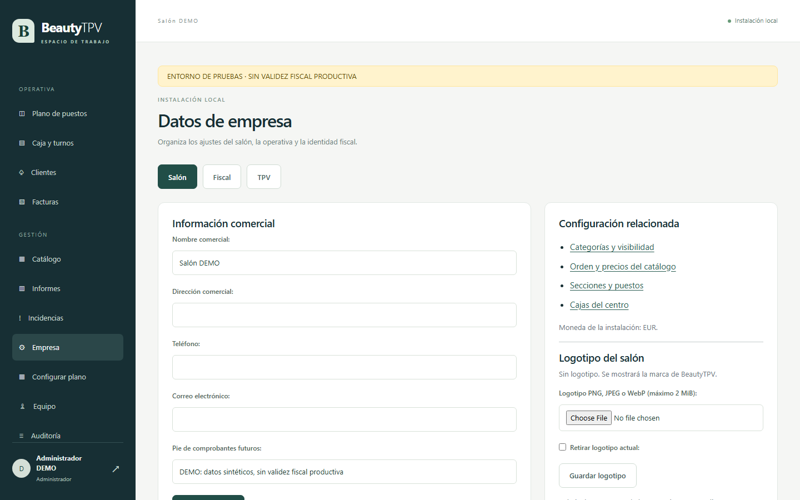

| Control de Salón | Función y restricción |
|---|---|
| Nombre y dirección comercial | Presentación comercial, distinta de razón social/domicilio fiscal |
| Teléfono y correo | Contacto; el correo se valida |
| Pie de comprobantes futuros | Texto comercial; se congela al emitir cada documento |
| Logotipo / Retirar logotipo | Formulario separado con **Guardar logotipo**; elegir subir o retirar, no ambos |
| Configuración relacionada | Enlaces reales a categorías, catálogo, plano y cajas; terminales/certificado se reservan al Superadmin |

El logo admite PNG/JPEG/WebP hasta 2 MiB y 16 megapíxeles; se normaliza a PNG de hasta 600×600 y 256 KiB. No se admiten SVG ni contenido activo. El logo se usa en la interfaz; no se promete impresión raster ESC/POS en V1.

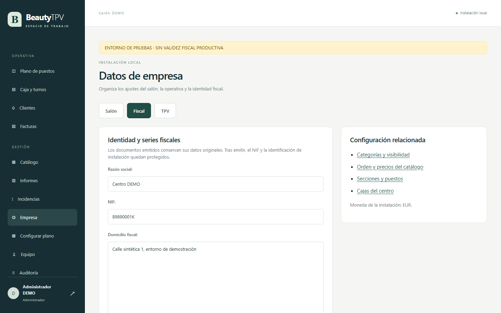

| Control de Fiscal | Función y restricción |
|---|---|
| Razón social, NIF, domicilio fiscal | Identidad del emisor; no sustituir por datos de otra empresa |
| Zona horaria | Zona IANA válida para presentación/fecha fiscal; por ejemplo Europe/Madrid |
| Productor / NIF del productor | Identificación del software para registros fiscales; requiere datos autorizados reales antes de producción |
| Identificador de instalación | No se cambia tras emitir la primera factura |
| Series simplificada/completa/rectificativa | Distintas, mayúsculas/números/guion/subrayado; afectan solo emisiones futuras. No edita el contador ni renumera documentos |

La moneda es EUR. Tras emitir, se rechaza cambiar NIF o identificador de instalación; una instalación no se reasigna a otro obligado. Cambiar nombre, domicilio, contacto o series no reescribe snapshots, PDF, huellas ni trabajos de impresión históricos. El certificado y entorno de remisión se gestionan por Superadmin; en DEMO están fijados a TEST sin certificados.

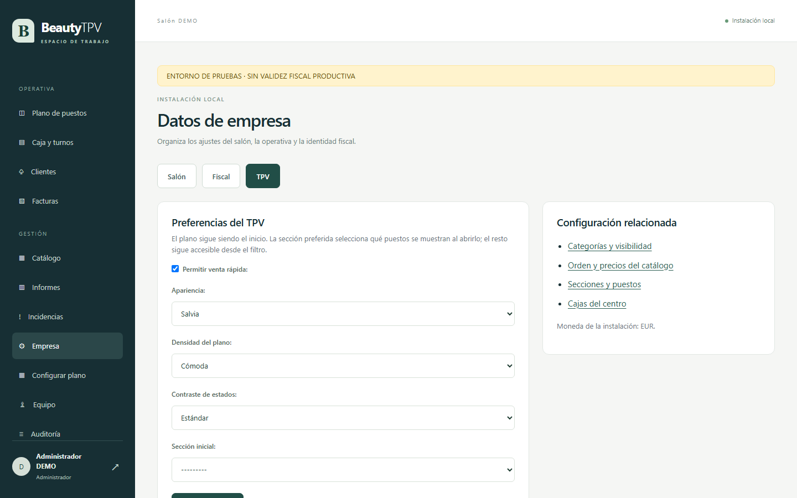

| Control de TPV | Función |
|---|---|
| Permitir venta rápida | Habilita la cuenta sin puesto; no cobra automáticamente |
| Apariencia | Opciones Salvia/Océano, sin CSS libre |
| Densidad del plano | Cómoda/Compacta |
| Contraste de estados | Estándar/reforzado; siempre conserva texto de estado |
| Sección inicial | Filtro inicial del plano; el resto sigue accesible desde su selector |

**Resultado:** configuración persistida por categoría. El plano continúa como inicio; no existe redirección inicial a URLs arbitrarias. **Errores:** revisar validaciones junto al campo; no omitir el guard fiscal ni cambiar la base directamente para forzar un guardado.

## 2. Servicios, productos y categorías

**Objetivo:** mantener el catálogo disponible al personal. **Antes:** Admin elevado y tipos impositivos revisados para el negocio.

1. Abra **Catálogo**. Busque por nombre y utilice filtros de tipo, categoría o actividad disponibles.
2. Pulse la creación de artículo o **Editar** uno existente.
3. Complete tipo Servicio/Producto, nombre, categoría, precio **IVA incluido**, IVA, actividad y orden.
4. Guarde y compruebe el listado/TPV.
5. Para retirar una oferta futura, desmarque **Activo**; no borre documentos anteriores.

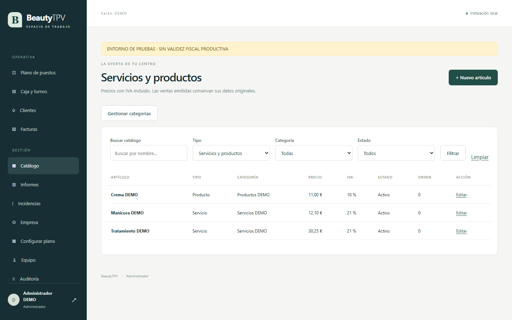

El orden se guarda como entero no negativo; los empates se ordenan de forma estable. Los precios/descripciones/IVA de facturas emitidas son snapshots: cambiar catálogo no cambia el historial.

Para categorías:

1. Abra **Categorías** desde Catálogo o Empresa.
2. Escriba nombre, orden y **Visible en TPV**; guarde.
3. Use **Editar** para modificar y **Eliminar** solo si no tiene artículos.

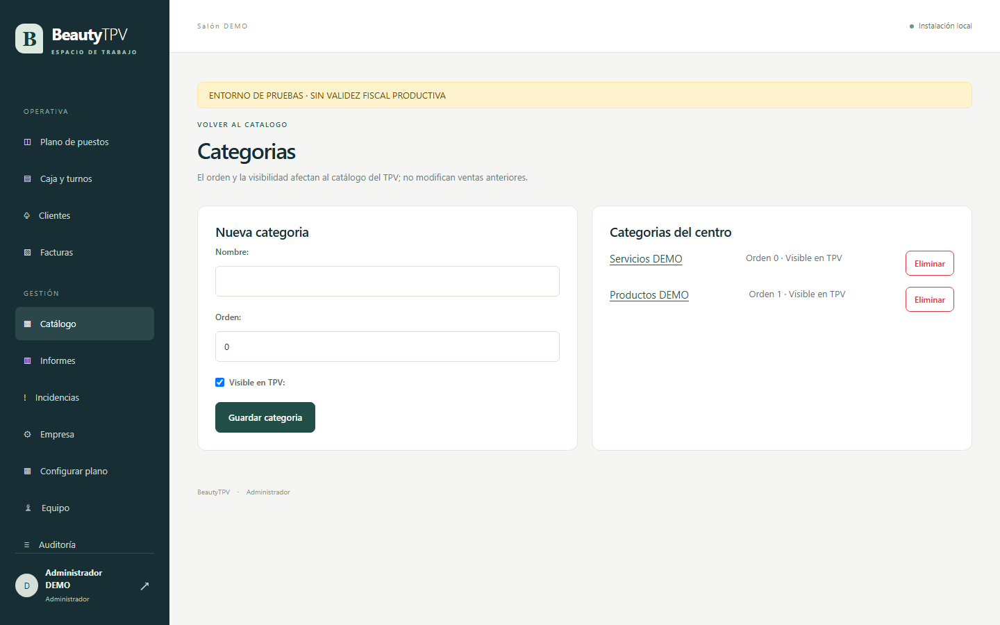

**Resultado:** ocultar categoría excluye nuevas adiciones, también por el servidor; no elimina líneas ya guardadas. Los artículos sin categoría siguen disponibles si están activos. **Errores:** nombre duplicado o categoría con artículos impiden guardar/eliminar; reasigne primero los artículos si es legal hacerlo.

## 3. Secciones y puestos

**Objetivo:** organizar el plano sin romper cuentas activas. **Antes:** conocer qué puestos se están usando.

1. Abra **Configurar plano**.
2. Cree o edite una sección con nombre y orden.
3. Cree o edite el puesto: sección, código único, nombre, actividad y orden.
4. Guarde y revise el plano.
5. Use desactivación para retirar un puesto; eliminación solo cuando no exista historia protegida.

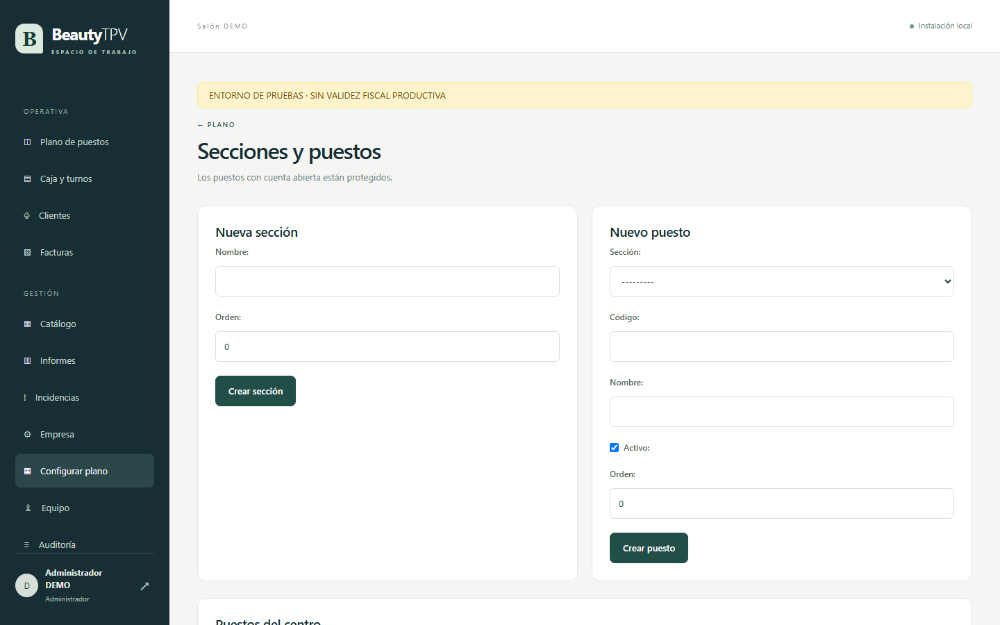

**Resultado:** cuadrícula por secciones actualizada; no hay editor gráfico de coordenadas en V1. **Restricciones:** no desactivar ni reasignar sección de un puesto con cuenta abierta/en cobro. No borrar puestos con historial ni secciones que aún tengan puestos. Los filtros del listado no cambian datos.

## 4. Cajas configuradas y operación de turnos

**Objetivo:** configurar cajas y conciliar efectivo. **Antes:** Admin elevado para configuración; Encargado o superior para movimientos/cierre.

1. En **Caja y turnos**, pulse **Configurar cajas** o abra el enlace desde Empresa.
2. Cree o edite nombre, actividad y terminal asociada.
3. Guarde; una caja sin terminal es compartida del servidor.
4. Desactive solo cuando no tenga turno abierto. No se permite reasignarla de terminal con turno abierto.

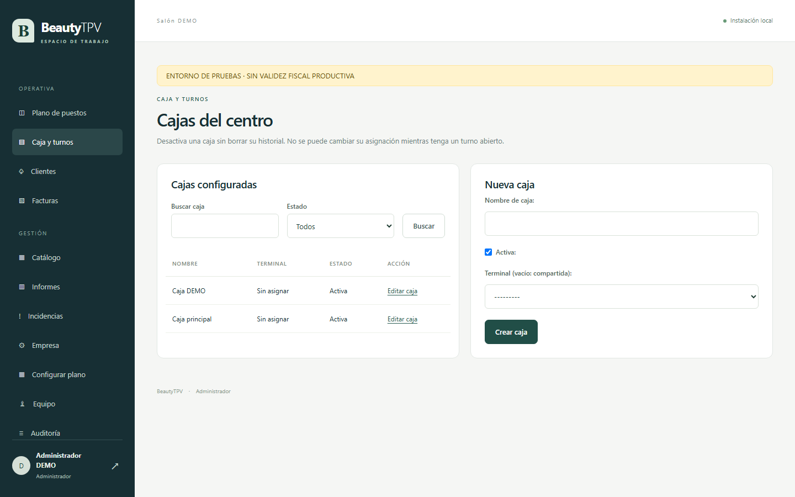

Las terminales y sus dispositivos se crean por Superadmin. Sus preferencias proponen una caja/sección, sin conceder permisos. Una caja asociada requiere terminal activa; las sesiones anteriores no se editan retrospectivamente.

### Abrir y cerrar turno

1. Seleccione caja e importe inicial; pulse **Abrir turno**. La apertura por Empleado se conserva en V1.
2. Durante el turno, Encargado o superior registra **Ingreso/Retirada**, importe positivo y motivo. No se permite retirada sin saldo suficiente.
3. Cuente el efectivo físicamente al terminar.
4. En **Arqueo y cierre**, introduzca el efectivo contado, pulse **Cerrar turno** y confirme.
5. Revise esperado, contado y diferencia. No vuelva a editar un turno cerrado.

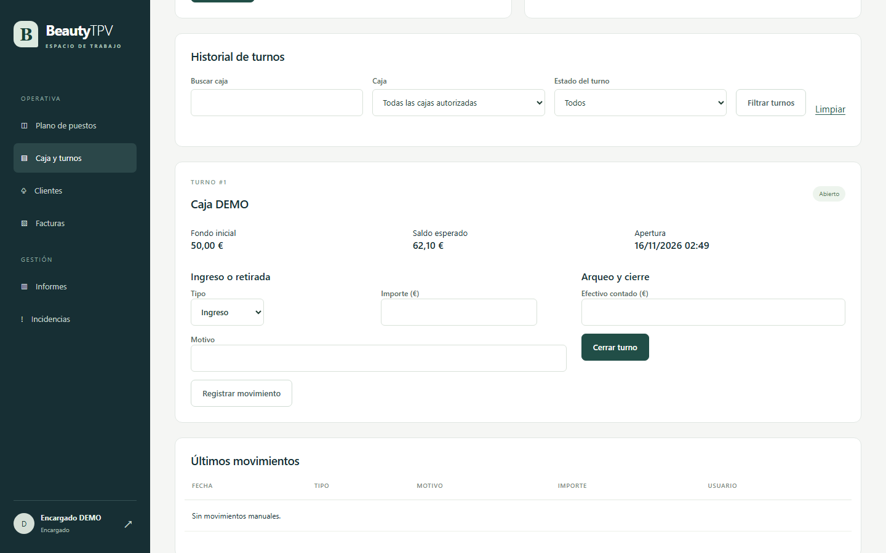

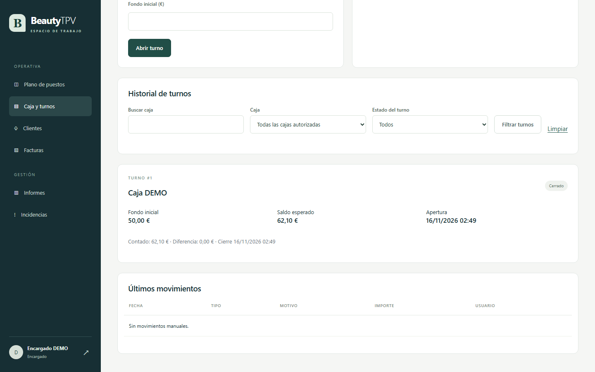

**Resultado:** cierre persistido con responsable y diferencia. El historial se busca/filtra por caja/estado; no hay CRUD de movimientos confirmados. **Si el saldo no coincide:** registre la incidencia y revise cobros/devoluciones; no borre movimientos para cuadrar.

## 5. Equipo y jerarquía

**Objetivo:** dar acceso y retirarlo de forma controlada. **Antes:** contraseña elevada y credenciales nuevas que cumplan validadores.

1. Abra **Equipo** y filtre usuario/nombre, rol o actividad.
2. Para alta, complete usuario, nombre, rol inferior, PIN de 6–12 dígitos y contraseña cuando corresponda.
3. En edición puede cambiar nombre, rol permitido, activo y nuevas credenciales. Campos de PIN/contraseña vacíos conservan las actuales.
4. Para impedir acceso futuro, desactive. Para cerrar accesos ya iniciados sin cambiar credenciales, use **Revocar sesiones** y confirme el aviso del navegador. La pantalla envía su confirmación; no hay un campo para escribirla.
5. Para un bloqueo temporal, solicite al Superadmin el desbloqueo visible en su pantalla de edición; el bloqueo por origen exige soporte técnico. No confunda restablecer PIN con retirar un bloqueo.

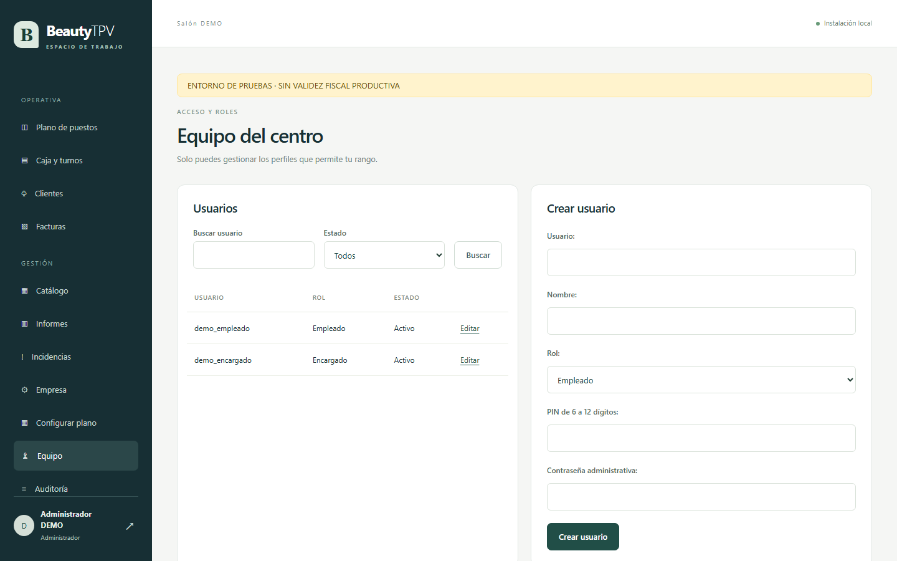

**Resultado:** operaciones auditadas. Cambiar rol, actividad, PIN o contraseña invalida sesiones y concesiones previas. Reactivar no resucita autorizaciones antiguas. **Restricciones:** Admin no crea ni modifica roles iguales o superiores, especialmente Superadmin. El identificador de usuario se mantiene estable; no se elimina historia para borrar un empleado.

## 6. Informes y exportaciones

**Objetivo:** revisar ventas y conciliación. **Antes:** Encargado o superior; en Superadmin, elevación y autorización PII.

1. Abra **Informes**.
2. Elija Desde/Hasta y, si conviene, caja, método, empleado y servicio/producto.
3. Pulse **Aplicar filtros**.
4. Revise ventas, operaciones, neto tras devoluciones, métodos, IVA, artículos, empleados, documentos y cancelaciones.
5. Use **Exportar CSV** con los filtros seleccionados y custodie el archivo como información del negocio.

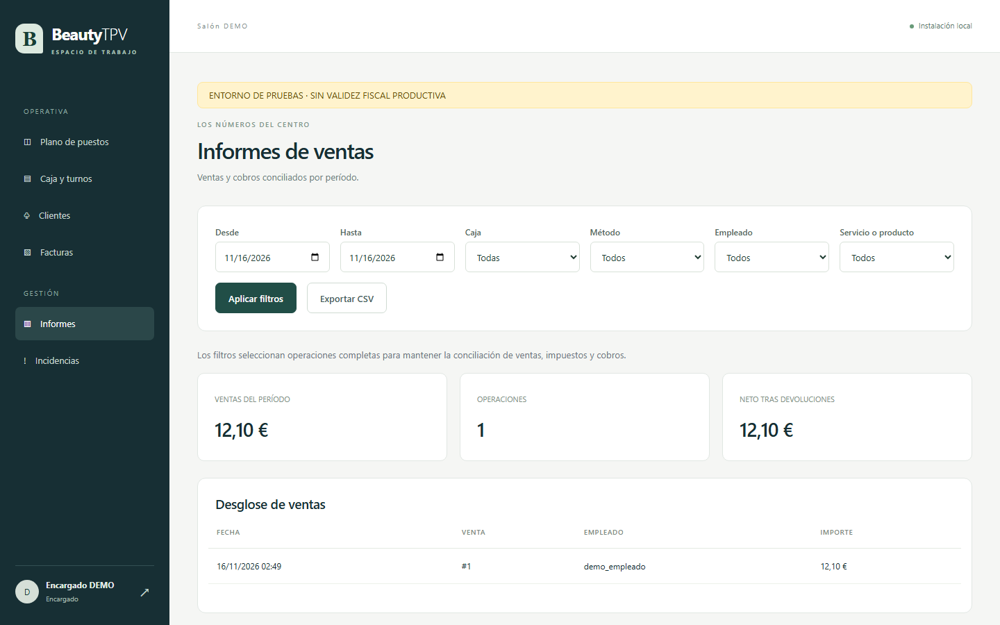

Los filtros seleccionan **operaciones completas** para mantener conciliación: no se reparte artificialmente el IVA de una venta entre filtros. Cancelaciones antiguas sin fecha verificable se advierten, sin atribuir fechas inventadas. El CSV protege fórmulas de texto de usuario; eso no elimina las obligaciones de custodia del export.

En **Clientes**, la exportación requiere Admin elevado; el borrado solo se ofrece a Admin y se rechaza si hay historia vinculada. [Guía de usuario](GUIA_USUARIO.md) explica fichas e historial.

## 7. Facturas, corrección y auditoría

**Objetivo:** tratar un error o devolución sin reescribir documentos. **Antes:** Encargado o superior y confirmación externa de devolución cuando sea tarjeta.

1. Abra la factura original desde **Facturas**.
2. Compruebe que no sea ya rectificativa ni esté rectificada.
3. En **Rectificar factura**, indique motivo, método y referencia confirmada. Para efectivo elija un turno abierto con saldo.
4. Confirme **Emitir rectificativa**. Revise el documento nuevo, la devolución y los informes.

**Resultado:** rectificación **total** R1/R5 del escenario soportado; original intacto. No existen devoluciones parciales ni un botón para editar el documento emitido. Una anulación registral fiscal no devuelve dinero: es otra operación reservada al soporte autorizado.

**Auditoría** permite consultar eventos según permisos; no modifica ni borra registros. Admin y Superadmin elevados pueden acceder, con filtros implementados en su pantalla. No exporte logs con secretos o datos innecesarios. Para incidencias operativas use **Incidencias**: describir sin personas/credenciales/XML, clasificar, registrar actuaciones y resolver; las actuaciones anteriores se conservan.

## 8. Límites y ayuda

| Situación | Acción |
|---|---|
| Datos fiscales bloqueados tras emitir | Mantener instalación del mismo obligado; consultar al responsable fiscal/técnico |
| Impresora/terminal/certificado | Solicitar Superadmin; no es una función de Admin |
| Cuenta o caja con actividad | Completar operación válida antes de desactivar/reasignar |
| Restore/actualización | Procedimiento técnico offline, nunca reemplazo de base viva por navegador |
| TEST | No usar como facturación productiva ni presentar como homologación |

Consulte la [guía del Superadmin](GUIA_SUPERADMIN.md), [VERI*FACTU](../integraciones/VERIFACTU.md), [permisos](../ROLE_PERMISSION_MATRIX.md) y el [índice](../README.md).
