# Guía del Superadmin

BeautyTPV 0.1.0 · revisión: 16-11-2026. Manual técnico-operativo del panel propio `/soporte/`; no es Django Admin ni una consola arbitraria de comandos. Las capturas proceden de una DEMO temporal independiente y no acreditan producción fiscal o dispositivos físicos.

## 1. Entrar, elevar y autorizar soporte

**Objetivo:** realizar una intervención atribuible, limitada y temporal. **Antes:** Superadmin activo, contraseña administrativa propia y un Administrador aprobador cuando el alcance lo requiera.

1. En identificación, marque **Acceder con contraseña** y entre con su propia contraseña.
2. Si la elevación caducó, use **Confirmar identidad** (`/elevar/`). La elevación dura diez minutos; el PIN no la concede.
3. Abra **Soporte técnico**.
4. En **Sesión de soporte**, escriba motivo, elija alcance, introduzca usuario aprobador y su contraseña autorizada, y pulse **Autorizar soporte**.
5. Compruebe alcance y vencimiento; cada autorización dura veinte minutos.
6. Al terminar, pulse **Revocar** en las autorizaciones activas y cierre su sesión.

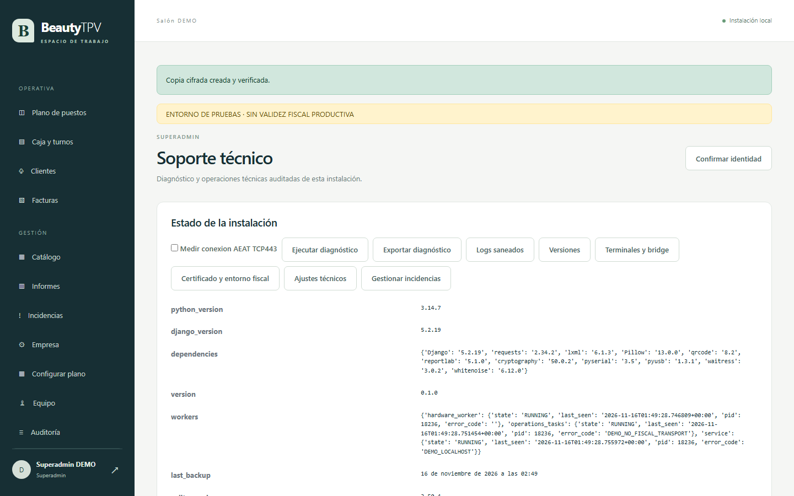

| Alcance | Uso |
|---|---|
| Técnico (`TECHNICAL`) | Diagnósticos, terminales, dispositivos, recuperación de colas y ajustes técnicos |
| Datos personales (`PII`) | Clientes, cuentas, facturas e informes comerciales |
| Copias (`BACKUP`) | Generar, verificar y descargar copias; preparar restauración |
| Actualización (`UPDATE`) | Validar un paquete desde el panel |

**Resultado:** autorización auditada con caducidad. Para PII debe aprobar **otro** Administrador/Superadmin activo: no se permite autoaprobación. Una autorización técnica no equivale a PII. La herencia de roles no elimina elevación ni scopes. Las contraseñas no se escriben en motivos, incidencias, logs ni capturas.

**Errores frecuentes:**403 por elevación vencida, scope ausente o aprobador inválido. No quite middleware ni utilice una cuenta compartida para superar el control. En DEMO, el aprobador de PII puede ser `demo_admin` con su contraseña aleatoria local; no hay una contraseña publicada en este manual.

## 2. Salud, sistema, versiones y registros

**Objetivo:** distinguir una instalación sana de una operativa parcial. **Permiso:** Superadmin elevado; diagnóstico profundo y exportación requieren alcance Técnico. **Riesgo:** consultas de integridad pueden consumir tiempo/IO; planifique fuera de picos cuando la base sea grande.

1. Abra **Soporte técnico** y revise la información de instalación.
2. Consulte versión del programa, Python, Django, dependencias, SQLite, integridad, latencia medida de consulta, disco, migraciones, colas y copias.
3. Pulse **Ejecutar diagnóstico** sin marcar red para comprobación local. Su respuesta es JSON real, no una pantalla gráfica adicional.
4. Use **Exportar diagnóstico** para un archivo saneado, y **Logs saneados** para los registros permitidos.
5. Antes de compartir un informe, revise destinatario, contenido y canal privado acordado.

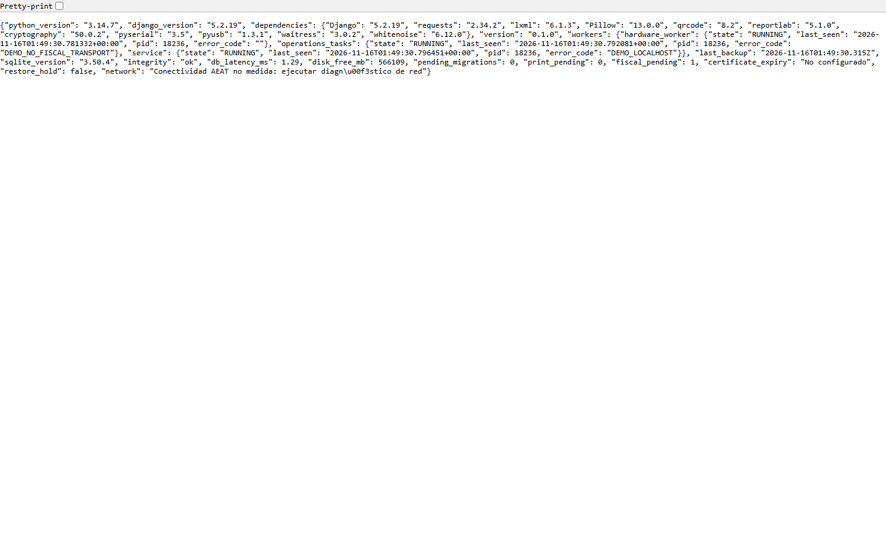

| Dato/control | Interpretación |
|---|---|
| Versión instalada | Procede de metadatos/release.json; no una versión elegida en un formulario |
| Integridad | Resultado de SQLite integrity_check; no prueba de aceptación AEAT |
| Migraciones pendientes | Indica si falta preparar el esquema; no ejecuta migraciones desde ese botón |
| Trabajadores | Heartbeats y estado; `STALE` exige investigar, no asumir que el trabajador sigue vivo |
| Último backup | Referencia local a copia completada; no sustituye restauración periódica |
| Cola de impresión/fiscal | Cifras persistidas, con incidencias o pendientes reales |
| Certificado | Caducidad/referencia comprobable; no se expone su clave privada |
| Medir conexión AEAT TCP 443 | Prueba de conectividad sin envío fiscal ni autenticación mTLS; no valida conformidad |
| Logs saneados | Vista limitada; no ofrece lectura arbitraria de archivos ni shell |

En DEMO no se permite la prueba externa de red, los certificados están vacíos y no se ejecuta el trabajador fiscal. En un servidor normal, el supervisor detiene la web si un hijo requerido muere para evitar una instalación que aparente estar sana. Vea [despliegue local](../instalacion/DESPLIEGUE_LOCAL.md) y [problemas](../instalacion/SOLUCION_PROBLEMAS.md).

## 3. Usuarios, credenciales, desbloqueo y revocación

**Objetivo:** mantener accesos sin borrar su trazabilidad. **Antes:** contraseña elevada; gestionar un usuario no implica conocer su contraseña actual.

1. Abra **Equipo**, busque por usuario/nombre y filtre rol/actividad.
2. Cree usuario con nombre, rol, PIN y contraseña cuando corresponda. Superadmin puede gestionar otros Superadmins; Admin solo inferiores.
3. En **Editar**, cambie nombre, rol permitido o actividad. PIN/contraseña nuevos vacíos conservan los actuales.
4. Para revocar accesos actuales conservando credenciales, pulse **Revocar sesiones** y confirme el aviso. La pantalla envía el valor de confirmación; no pide escribirlo.
5. Para quitar bloqueo temporal, use **Desbloquear PIN**. Si indica origen/IP, necesita autorización Técnica; no cambia el PIN.
6. Desactive un usuario que no deba seguir operando; no borre facturas o eventos para retirar un empleado.

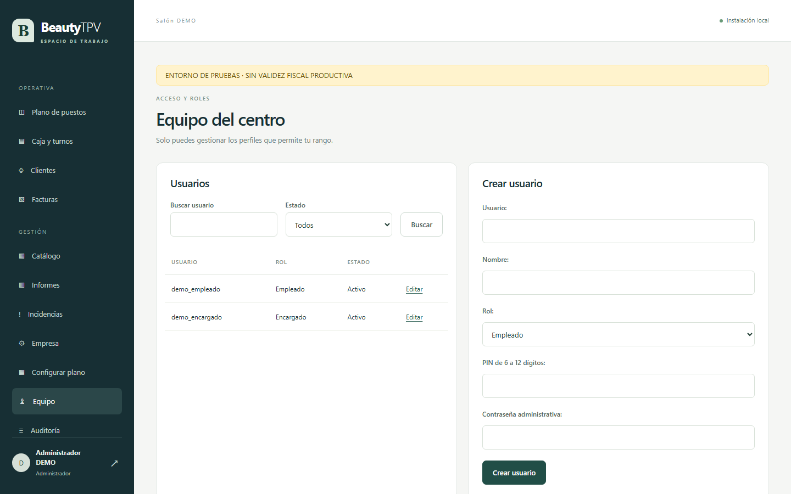

**Resultado:** cambios y revocaciones auditados. Reset de PIN/contraseña, rol o actividad invalida sesiones y autorizaciones vinculadas; reactivar no recupera concesiones viejas. La autorrevocación obliga a volver a entrar. No puede desactivar/degradar su propia sesión mediante ese formulario.

**Riesgos:** entregar credenciales por canal privado; no asignar PIN compartido ni una contraseña conocida por todos. El bloqueo por usuario y por origen son distintos; desbloquear uno puede dejar el otro activo. Los controles del servidor recargan rol/estado, evitando decisiones con objetos obsoletos.

## 4. Terminales y preferencias

**Objetivo:** atribuir operaciones y asociar dispositivos. **Permiso:** Superadmin elevado + Técnico. **Antes:** código único y decisión de caja compartida/por terminal.

1. Abra **Terminales y bridge**.
2. Busque por código/nombre y filtre activo/inactivo para localizar una existente, o use **Registrar terminal**.
3. Complete código, nombre, actividad, sección y caja preferidas.
4. Si requiere agente remoto, genere fuera del repositorio un token aleatorio de 32–256 caracteres e introdúzcalo como **Nuevo token del bridge**.
5. Guarde y configure la terminal del navegador/agente correspondiente.

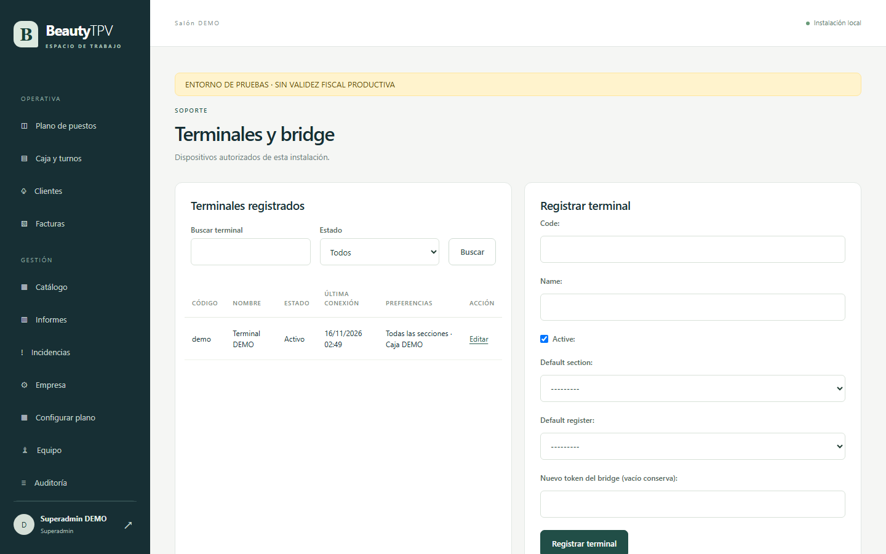

**Resultado:** preferencias persistidas; el token se guarda con hash y no se vuelve a mostrar. Vacío conserva el token anterior. Cambiarlo exige actualizar el agente remoto. Caja preferida debe estar activa y ser compartida o de esa terminal; la preferencia no concede acceso ni abre un turno. Última conexión refleja actividad real registrada, no una prueba completa de dispositivo.

No comparta el fichero SQLite para instalar una terminal. Un navegador accede a Django por red autorizada; un agente físico recibe trabajos por HTTPS con token/lease y journal. Instrucciones y prerequisitos exactos en [hardware](../integraciones/HARDWARE.md).

## 5. Impresoras, cajón y colas

**Objetivo:** registrar un destino real y tratar fallos sin repetir cobros. **Permiso:** Superadmin elevado + Técnico. **Antes:** conexión, firmware y compatibilidad contrastados con el fabricante.

1. Abra **Dispositivos** desde Soporte o **Configurar impresora** en su panel.
2. Complete los controles relevantes:

| Campo | Uso |
|---|---|
| Nombre | Identifica el dispositivo |
| Tipo | TCP, USB, serie o simulador permitido solo en desarrollo/DEMO explícita |
| Terminal | Enrutamiento por terminal; sin terminal es fallback local del servidor |
| Dirección/puerto | Host y puerto TCP, o puerto/velocidad serie según tipo |
| USB vendor/product/endpoint | Identificadores válidos del dispositivo USB |
| Encoding y codepage | Codificación admitida y página ESC/POS compatible; verificar acentos/euro |
| Habilitado | Ofrece el dispositivo para trabajos nuevos |
| Cortar papel / Cajón habilitado | Comportamiento de nuevos payloads; no modifica intenciones ya guardadas |

3. Guarde. En Soporte, pulse **Imprimir prueba** y, solo con cajón compatible, **Probar cajón** y confirme.
4. Revise **Trabajos recientes** y eventos; el proceso financiero no debe repetirse para resolver impresión.

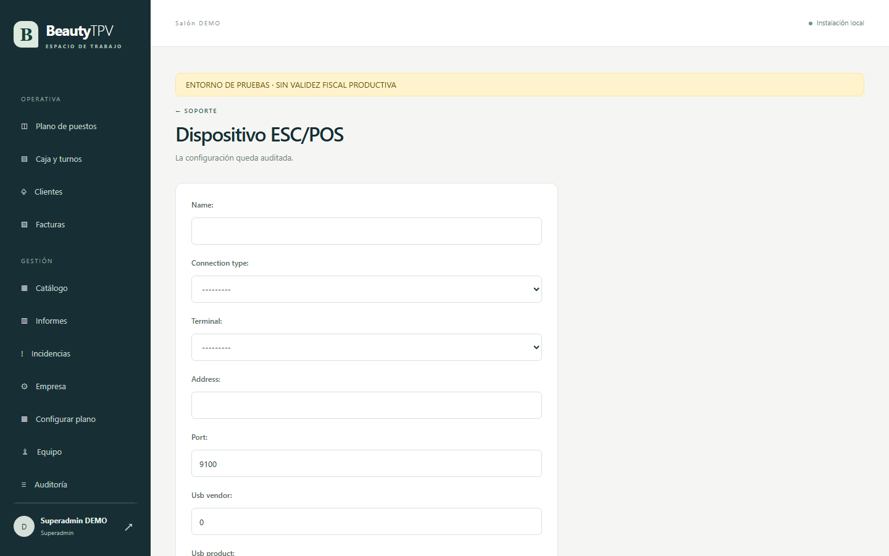

| Estado de trabajo | Actuación segura |
|---|---|
| PENDING | Comprobar destino habilitado y trabajador/agente |
| FAILED antes de envío | Revisar fallo y usar reintento autorizado; puede elegir impresora habilitada |
| SENDING | No cambiar destino/terminal de la impresora mientras entrega; esperar acuse/lease |
| UNKNOWN | Puede haberse entregado. No reenviar automáticamente; revisar físicamente y solicitar copia explícita sin cajón si procede |
| DONE | Transporte completado; en DEMO es consumo simulado de bytes, no confirmación de papel |

**Resultado:** pruebas/trabajos auditados. El cobro automático solo solicita cajón en efectivo y cuando la política lo permite; tarjeta y copias no lo abren. Desactivar cajón impide también su prueba. No use un comando de pulso incompatible ni conecte un cajón no homologado para su impresora.

**Bloqueo externo:** no hay modelo/firmware físico declarado probado. Legibilidad80mm, corte, lectura QR y apertura real requieren checklist y evidencias de dispositivo. No confunda el simulador con esos ensayos.

## 6. Cola fiscal, certificado y correcciones

**Objetivo:** conservar registros y tratar incidencias conforme al escenario soportado. **Permiso:** Superadmin elevado + Técnico para operaciones de soporte; PII separada para documentos comerciales.

1. Consulte **Cola fiscal** en Soporte y su filtro de estado.
2. Revise registro, estado, intentos y próximo intento.
3. Use **Revisar/recuperar** solo para estados que el servicio permita reprogramar; no convierta un pendiente/rechazo en aceptado manualmente.
4. Un rechazo puede ofrecer **Subsanar rechazo**: crea nuevo registro conservando el original; no permite reescribir la factura.
5. **Anulación registral** exige motivo y confirmación `ANULAR REGISTRO`. Solo trata un registro emitido por error; no devuelve dinero. Una devolución comercial requiere rectificativa.

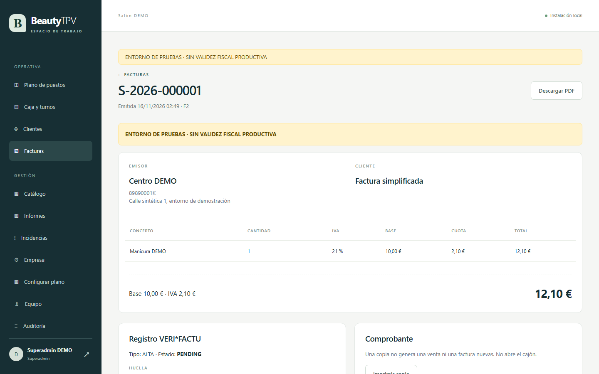

En **Certificado y entorno fiscal** se configuran referencias a PEM externo y clave externa, con validación de formato, correspondencia y caducidad; los bytes de clave no se guardan en DB. El entorno productivo continúa bloqueado sin evidencias de validación. En DEMO la página es de consulta: TEST fijo, sin certificados ni remisión.

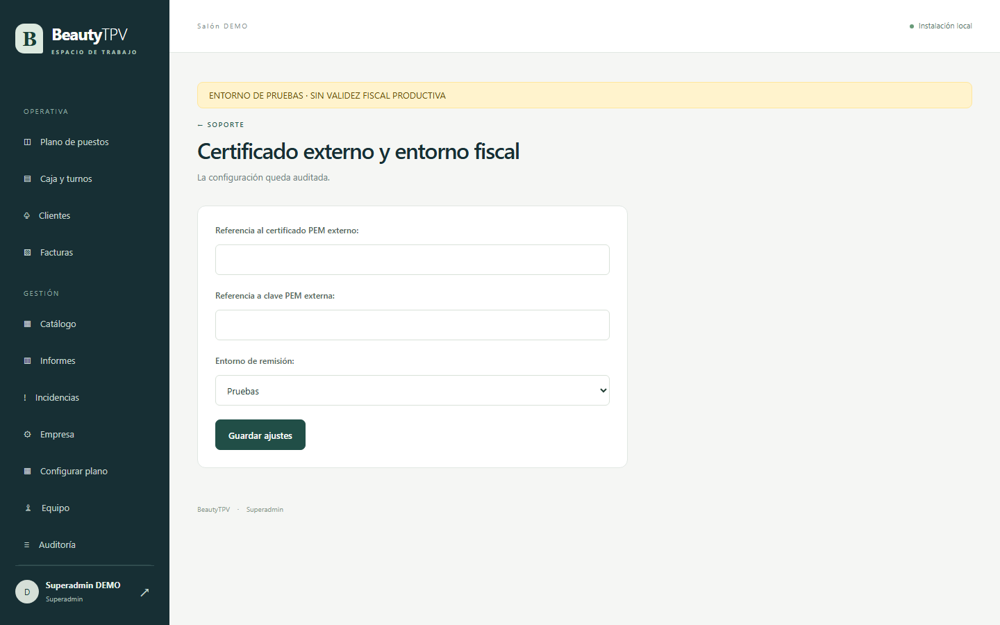

**Resultado:** trazabilidad, no aceptación inventada. `DUPLICATE_REVIEW` requiere conciliación; `ACCEPTED_WITH_ERRORS` no se trata como un rechazo cualquiera. Nunca fuerce estados por SQL ni reactive producción basándose solo en XSD o una conexión TCP. Consulte [VERI*FACTU](../integraciones/VERIFACTU.md) y la declaración responsable pendiente de firma del productor.

## 7. Copias: política, generación, verificación y descarga

**Objetivo:** disponer de recuperación auténtica. **Permisos:** Técnico para política; BACKUP para crear/verificar/descargar. **Riesgo:** una copia puede contener datos personales; custodia y clave externa son obligatorias.

1. En **Ajustes técnicos**, establezca intervalo de backup y retención en días, ambos positivos. El trabajador aplica la política; no es una promesa de copia externa automática.
2. Autorice alcance **Copias** y pulse **Crear copia cifrada** en Soporte.
3. Compruebe la entrada con fecha y nombre en el historial local.
4. Pulse **Verificar copia** para comprobar autenticación/hash/contenido sin activar mantenimiento ni sustituir DB.
5. Descargue desde el enlace autorizado y custodie fuera del equipo según el plan del negocio.
6. Programe ensayos periódicos de restauración en un destino independiente.

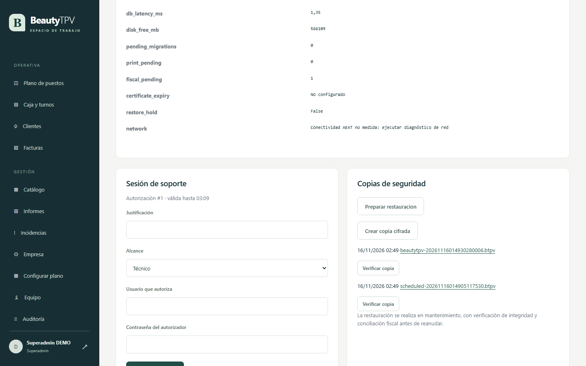

**Resultado:** copia consistente mediante API SQLite, cifrada con clave externa, y eventos de auditoría. La política conserva al menos la copia más reciente satisfactoria; no equivale a un sistema de backup cloud. El logo almacenado en DB queda incluido.

**Errores:** clave/ruta/permisos/integridad incompatibles requieren diagnóstico; no deje la clave junto a una copia compartida ni suponga que poder descargarla prueba restauración. Más detalle en [backup/restore](../instalacion/BACKUP_RESTORE.md).

## 8. Preparar y ejecutar restauración offline

**Objetivo:** recuperar sin reemplazar una base viva ni duplicar registros. **Permiso:** Superadmin elevado + BACKUP en web, acceso OS autorizado para el procedimiento offline. **Antes:** ventana de mantenimiento, copia seleccionada y acuses/evidencias actuales preservados.

1. Abra **Preparar restauración**.
2. Seleccione una copia registrada y escriba `PREPARAR RESTAURACION`.
3. Confirme. La web verifica y activa mantenimiento, mostrando marcas fiscales/diferencias; **no restaura la DB en uso**.
4. Cierre terminales y detenga servicio, agentes y trabajadores. El lock exclusivo debe obtenerse antes de sustituir.
5. Ejecute el procedimiento de `scripts/restore.ps1` con instancia, archivo y confirmación, siguiendo el runbook enlazado.
6. Verifique integridad, documentos, secuencias, acuses y trabajos potencialmente entregados. La retención fiscal permanece activa.
7. Solo tras conciliación documentada, un Superadmin ejecuta `reconcile_restore` con contraseña/evidencia/confirmación y reanuda el servicio.

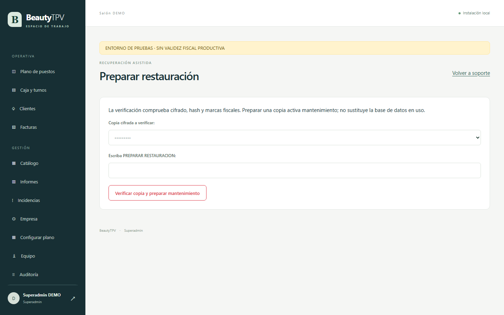

**Resultado:** recuperación controlada con copia previa/hold, sin borrar documentos emitidos. La diferencia de identificadores mostrada no es un recuento exacto de operaciones perdidas. La revisión local de cadena no autentica por sí sola los acuses AEAT ni sustituye la conciliación humana.

**No hacer en servicio activo:** sustituir SQLite, borrar marcadores para saltar conciliación o reenviar automáticamente todo el spool restaurado. Para cancelar solo la preparación web, puede desactivar mantenimiento desde Ajustes técnicos; no retire un hold de restore sin el procedimiento completo.

## 9. Actualización, preflight y rollback

**Objetivo:** aplicar una versión revisada preservando historia fiscal. **Permiso:** Superadmin elevado + UPDATE para preflight web; acceso OS y parada para aplicar. **Antes:** paquete local del canal acordado, SHA256 independiente y copia verificada.

1. Abra **Versiones** y compruebe versión instalada e historial.
2. Introduzca ruta del paquete ZIP local y SHA256; pulse **Comprobar paquete y SHA-256**.
3. Revise el resultado. Este botón **valida, no instala**.
4. Coordine mantenimiento y detenga servicio/trabajadores/agentes.
5. Ejecute `scripts/update.ps1` según el [runbook de actualizaciones](../instalacion/ACTUALIZACIONES.md).
6. El procedimiento exige backup previo, valida rutas/hashes/dependencias y ejecuta migrate/check/collectstatic.
7. Verifique versión, esquema y recorridos antes de reabrir.

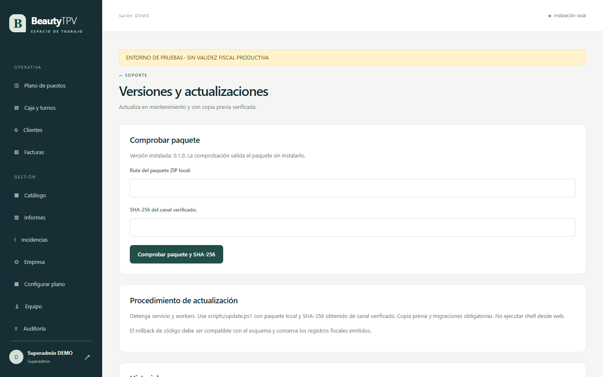

**Resultado:** actualización controlada y registrada. No existe un catálogo remoto automático de versiones ni una consola de comandos web. Si el entorno de dependencias no coincide, el preflight aborta; no se promete rollback del venv.

**En fallo:** el rollback devuelve código y `release.json`, conserva DB/migraciones/documentos y deja retención cuando corresponda. No revierte una base fiscal para hacer coincidir un código viejo. Si código anterior y esquema no son compatibles, mantenga servicio parado y aplique corrección del productor.

## 10. Mantenimiento e incidencias

**Objetivo:** intervenir dejando actuaciones trazables. **Permiso:** Técnico para ajustes y para incidencias técnicas de Superadmin.

1. En **Ajustes técnicos**, active mantenimiento cuando la intervención lo requiera; informe a operadores y compruebe que se bloquea nueva operativa.
2. En **Incidencias**, filtre por texto, estado, categoría y prioridad.
3. Registre título y descripción sin nombres, tarjetas, certificados, XML, contraseñas ni logs completos.
4. Abra **Consultar y actuar**, añada actuación/motivo y clasificación/estado; guarde.
5. Resuelva con nota o reabra justificadamente si reaparece. Ante conflicto de versión, recargue antes de guardar.
6. Revise auditoría y cierre las autorizaciones al terminar.

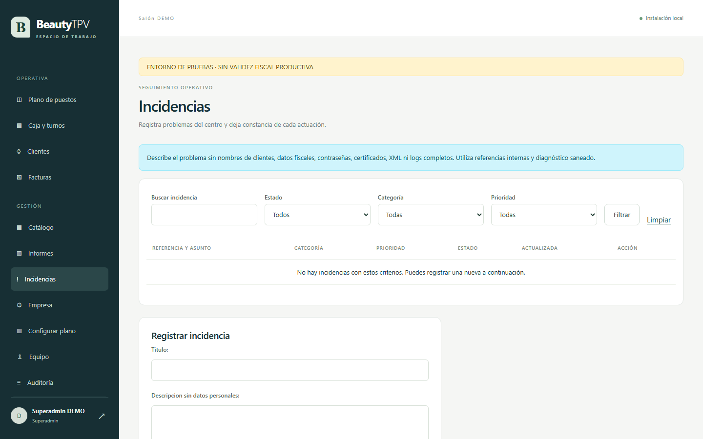

**Resultado:** actuaciones append-only y cambios con control de concurrencia. Manager/Admin solo gestionan categoría operativa; Superadmin puede categorías técnicas con elevación/TECHNICAL. Los patrones de privacidad rechazan identificadores conocidos, pero no son un detector universal: el operador debe omitir cualquier dato identificable.

**No hacer:** pegar una respuesta fiscal completa, editar actuaciones previas o borrar historia para «resolver» un incidente. Los registros de auditoría tampoco se modifican desde el panel.

## 11. Orden seguro ante un fallo

1. Identificar si afecta a cobro, impresión, remisión o infraestructura; no repetir cobros confirmados.
2. Conservar factura, cuenta, outbox y trabajo; recoger diagnóstico saneado.
3. Si hay riesgo de operativa parcial, activar mantenimiento y coordinar parada.
4. Recuperar solo mediante transiciones disponibles; UNKNOWN exige revisión, no reenvío indiscriminado.
5. Si hay restore/update, seguir runbook offline con backup/conciliación.
6. Documentar actuación, prueba posterior y responsable antes de reabrir.

Fuentes de verdad: [seguridad](../arquitectura/SEGURIDAD.md), [hardware](../integraciones/HARDWARE.md), [SQLite](../integraciones/SQLITE.md), [VERI*FACTU](../integraciones/VERIFACTU.md), [auditoría documental](../DOCUMENTATION_AUDIT.md) e [índice](../README.md). La ausencia de certificado, hardware real, revisión fiscal experta y aceptación del equipo/personas del salón sigue siendo **BLOQUEADO EXTERNO**.
