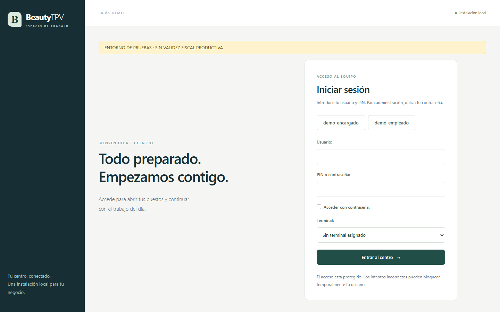
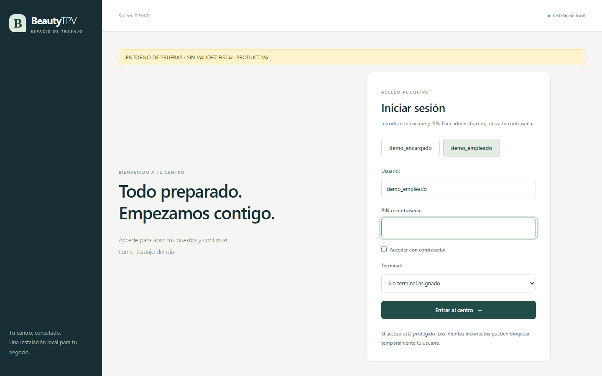
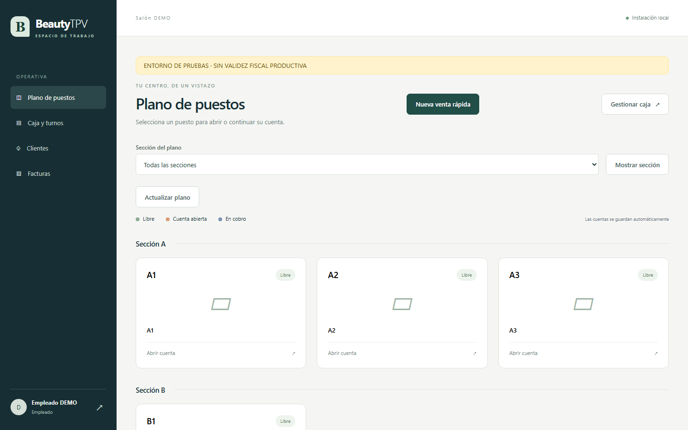
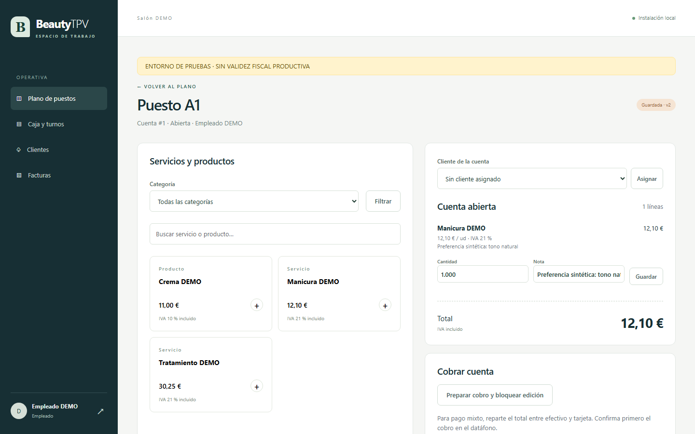
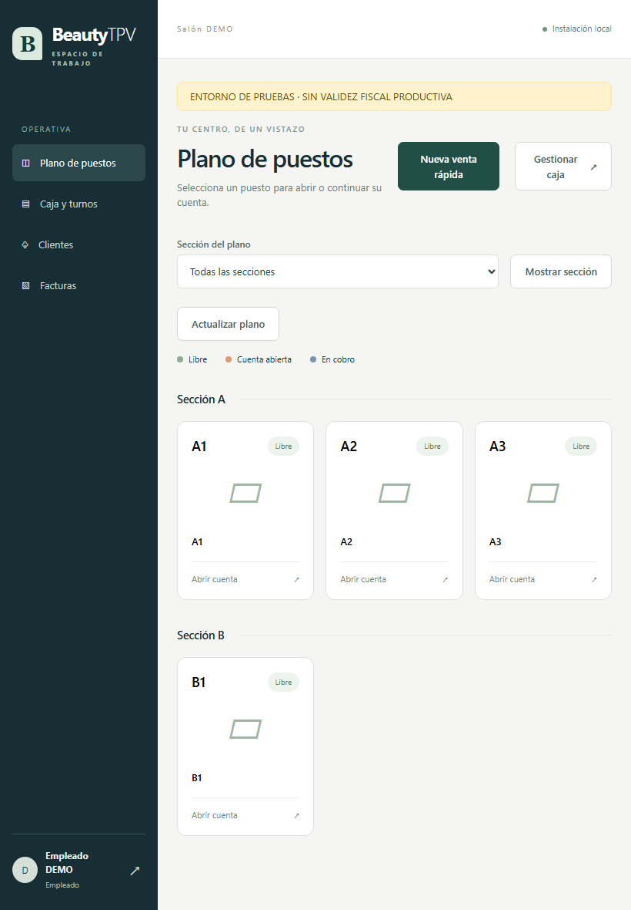
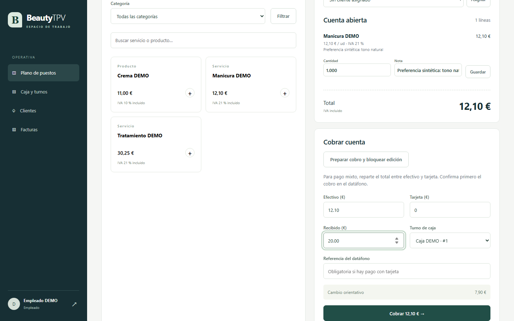
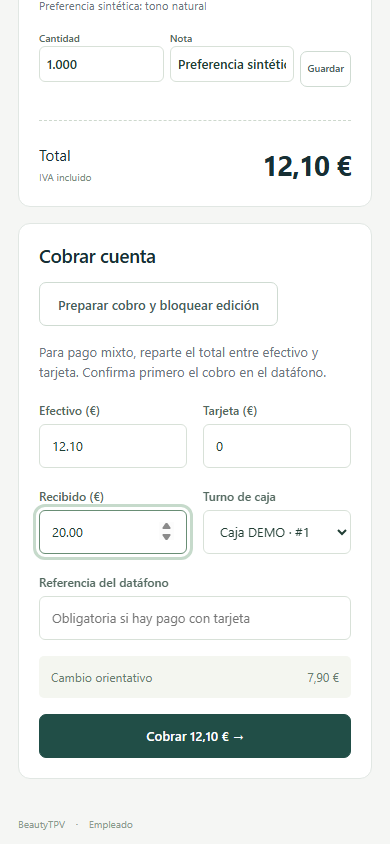
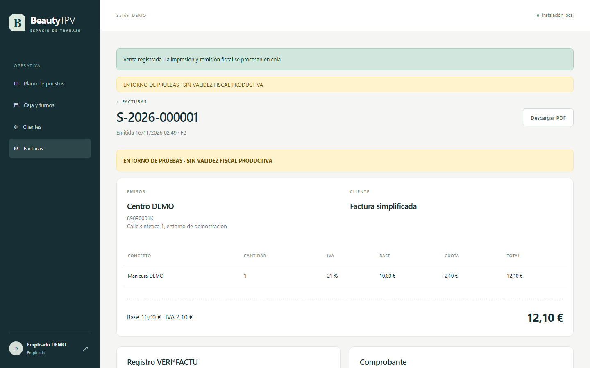
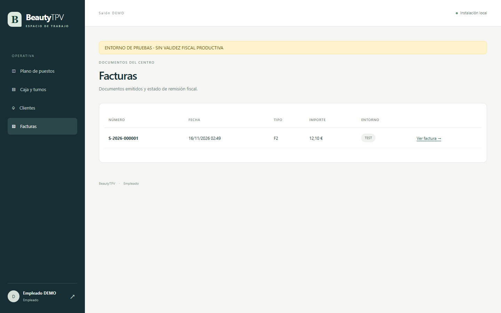
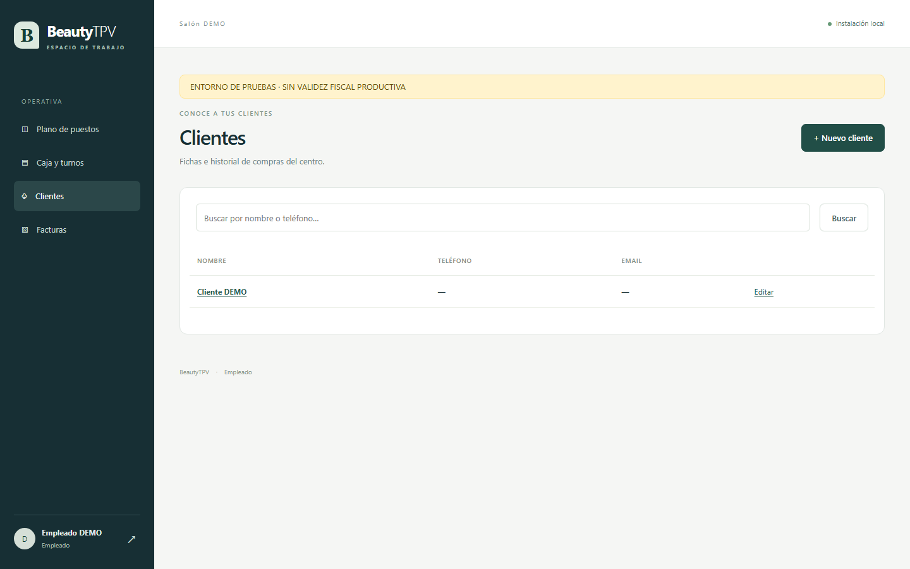

# Guía de uso de BeautyTPV

Versión documentada: **0.1.0**. Revisión: 16-11-2026. Dirigida al personal del salón. Las imágenes son capturas reales de una instalación temporal con datos **DEMO**; no muestran clientes reales ni una validación fiscal productiva.

BeautyTPV organiza el trabajo como un plano de mesas: cada puesto mantiene su propia cuenta. Añadir un servicio guarda la cuenta; cobrarla crea la venta y su documento. Una factura emitida ya no se edita.

## 1. Abrir el programa e identificarse

**Objetivo:** entrar con sus permisos. **Antes:** necesita un usuario activo y su PIN o contraseña facilitados por el responsable.

1. En Windows, abra el acceso **BeautyTPV DEMO** si está probando la demostración. En el salón real, use el acceso preparado por su instalador.
2. Espere a que aparezca el navegador. No necesita mantener una terminal abierta para usar la DEMO.
3. Pulse su nombre en el selector o escriba su usuario.
4. Introduzca su PIN. Admin y Superadmin deben usar su contraseña y marcar **Acceder con contraseña** para administrar.
5. Seleccione la terminal que corresponda, si se ha configurado, y pulse **Entrar al centro**.

**Resultado:** aparece el plano. **Si falla:** revise usuario, PIN y casilla de contraseña. Los intentos repetidos pueden bloquear temporalmente el acceso; no pruebe PIN al azar. Solicite al responsable un desbloqueo o restablecimiento. Las credenciales de la DEMO se consultan en **Usuarios BeautyTPV DEMO**, nunca en este manual. Consulte [arranque DEMO](../instalacion/ARRANQUE_DEMO.md).

## 2. Entender el plano y elegir un puesto

**Objetivo:** localizar el trabajo pendiente. **Antes:** sesión iniciada.

1. Abra **Plano de puestos** en el menú.
2. Observe las secciones y el texto de cada tarjeta; no dependa solo del color.
3. Si hay varias secciones, use **Sección del plano** y **Mostrar sección**. **Actualizar plano** solicita el estado actual.
4. Pulse el puesto en el que va a trabajar.

| Estado visible | Significado | Qué hacer |
|---|---|---|
| Libre | No tiene cuenta activa | Pulsar crea o recupera una cuenta única |
| Cuenta abierta | Hay servicios/productos guardados | Pulsar recupera la misma cuenta y su total pendiente |
| En cobro | La cuenta está preparada para pagar | Completar cobro o usar **Volver a editar cuenta** antes de cambiarla |

**Resultado:** se abre la cuenta del puesto. **Si otro compañero la cambió:** recargue y revise las líneas antes de continuar. La aplicación evita que dos terminales creen una cuenta activa diferente en el mismo puesto.

## 3. Abrir una cuenta y añadir tratamientos o productos

**Objetivo:** registrar lo que se va a cobrar. **Antes:** puesto disponible y catálogo configurado por el Administrador.

1. Pulse un puesto libre.
2. Busque por nombre o seleccione una categoría y pulse **Filtrar**.
3. Pulse el botón **+** del tratamiento o producto.
4. Compruebe descripción, cantidad, precio, IVA y total en el carrito.
5. Repita para los demás artículos.

**Resultado:** cada adición queda guardada en el servidor. **Si no aparece un artículo:** puede estar desactivado o pertenecer a una categoría oculta; solicite revisión del catálogo. No invente una línea o precio fuera de los controles disponibles.

La **Venta rápida**, si el Administrador la habilitó, permite trabajar sin puesto. Es también una cuenta persistente; no es una venta cobrada automáticamente.

## 4. Cantidades, notas y operaciones restringidas

**Objetivo:** corregir una cuenta antes del cobro. **Antes:** cuenta abierta, fuera del estado en cobro.

1. En la línea, escriba la cantidad y/o una nota útil, sin datos personales innecesarios.
2. Pulse **Guardar** en esa línea.
3. Revise el total actualizado.
4. Para reducir cantidad, quitar una línea, cambiar un descuento o anular la cuenta, solicite a un Encargado o superior que actúe con su propia sesión.

**Resultado:** cambios persistidos. **Si recibe403 o no aparece la acción:** su rol no la autoriza. No use la sesión de otra persona. Empleado puede aumentar cantidades y guardar notas; las reducciones, retirada de líneas y descuentos requieren Encargado. Las notas admiten hasta 500 caracteres.

## 5. Guardar, volver y recuperar; cambiar entre puestos

**Objetivo:** atender varios puestos sin perder cuentas. **Antes:** las últimas modificaciones de cada línea deben haberse enviado con **Guardar**.

1. Pulse **Volver al plano**.
2. Abra otro puesto y añada sus artículos.
3. Regrese al plano y pulse el primer puesto ocupado.
4. Compruebe que conserva sus líneas y notas.

**Resultado:** cada puesto mantiene su cuenta, incluso al volver a entrar tras reiniciar el servidor. No hay un botón global de «guardar carrito»: añadir artículos y guardar cada línea son las operaciones que persisten los datos. **Si se cortó la conexión:** recargue, revise qué llegó al servidor y solo después repita lo que falte.

## 6. Preparar el cobro

**Objetivo:** revisar la cuenta antes de emitir el documento. **Antes:** cuenta con total positivo; datos del cliente cuando sean necesarios; turno abierto si se va a recibir efectivo.

1. Revise líneas, cantidades y total.
2. Si corresponde, seleccione el cliente y pulse **Asignar**.
3. Puede pulsar **Preparar cobro y bloquear edición**. La cuenta pasa a **En cobro** y conserva sus datos.
4. Si necesita corregirla, pulse **Volver a editar cuenta** antes de cambiar líneas o cliente.
5. Complete los importes y la confirmación de pago. Los importes de efectivo y tarjeta deben sumar exactamente el total.

**Resultado:** la cuenta queda preparada; aún no se ha cobrado por el mero hecho de prepararla. **Si falta caja o el total no cuadra:** corrija el dato indicado; no se genera una venta parcial.

## 7. Cobrar efectivo y entregar cambio

**Objetivo:** registrar el cobro y el efectivo realmente debido. **Antes:** Caja y turno abiertos.

1. En **Efectivo (€)**, escriba la parte del total que se paga en efectivo.
2. Deje **Tarjeta (€)** a cero si todo es efectivo.
3. En **Recibido (€)**, escriba lo entregado por el cliente.
4. Seleccione el **Turno de caja** correcto.
5. Revise el **Cambio orientativo**. Ejemplo DEMO: total 12,10, recibido 20,00, cambio 7,90.
6. Pulse **Cobrar** y confirme la emisión.
7. Espere a la pantalla de la factura antes de dar la operación por terminada.

**Resultado:** una venta, una factura, su registro fiscal y un trabajo de impresión; el puesto se libera. La caja aumenta por la parte de la venta cobrada en efectivo, no por todo el dinero recibido antes de devolver cambio. El cajón se solicita solo si está configurado y habilitado.

**Si falla la impresión:** no vuelva a cobrar. La factura y la venta pueden estar correctamente guardadas. Consulte el documento y solicite una copia o soporte. En la DEMO no se abre ningún cajón físico.

## 8. Cobrar tarjeta o pago mixto

**Objetivo:** registrar un pago ya confirmado fuera de BeautyTPV. **Antes:** disponer del datáfono externo y confirmar allí el pago; BeautyTPV no realiza cargos bancarios.

1. Para solo tarjeta, deje efectivo a cero e indique el total en **Tarjeta (€)**.
2. Escriba la **Referencia del datáfono** confirmada; es obligatoria cuando hay tarjeta.
3. Para mixto, reparta el total entre efectivo y tarjeta. Ejemplo: efectivo 5,00 y tarjeta 7,10 para total 12,10.
4. Si hay efectivo, indique recibido y turno abierto. El cambio se calcula respecto a la parte de efectivo.
5. Pulse **Cobrar**, confirme y espere el documento.

**Resultado:** componentes conciliados; solo el efectivo afecta al saldo de caja. **Si el datáfono rechazó el pago:** no lo registre como confirmado. Si el navegador se interrumpe después de confirmar, consulte primero la cuenta y la factura; no repita el cobro bancario sin verificar.

## 9. Factura, PDF e impresión de copia

**Objetivo:** entregar el comprobante de una operación guardada. **Antes:** cobro completado o documento autorizado en **Facturas**.

1. Abra la factura que acaba de emitir o búsquela en **Facturas**.
2. Revise emisor, cliente, líneas, IVA y total.
3. Pulse **Descargar PDF** para obtener el documento.
4. Si necesita otra impresión, pulse **Imprimir copia**.
5. Revise el estado del registro VERI*FACTU sin confundir «pendiente» o impresión realizada con aceptación oficial.

**Resultado:** una copia identificada, sin crear otra venta/factura y sin abrir el cajón. Empleado solo consulta/reimprime los documentos que le corresponden. **Si hay error en una factura emitida:** no se borra ni se edita; el Encargado debe aplicar el procedimiento de rectificación autorizado. La devolución disponible es total, no parcial.

Las facturas TEST llevan aviso de falta de validez fiscal productiva. El QR y su enlace no son una prueba de homologación ni de aceptación; no pulse enlaces externos durante la DEMO offline.

## 10. Consultar actividad, clientes y caja

**Objetivo:** revisar las operaciones permitidas. **Antes:** sesión con el rol adecuado.

1. En **Facturas**, consulte sus documentos permitidos y abra el detalle.
2. En **Clientes**, busque por nombre o teléfono y abra la ficha para consultar su historial autorizado.
3. En **Caja y turnos**, consulte turnos activos y los propios según su rol.
4. Encargado o superior puede abrir **Informes**, seleccionar período y filtros y revisar los desgloses.

**Resultado:** consulta sin modificar la historia. **Si no ve Informes, Catálogo o Soporte:** puede ser correcto para su rol. Cliente es una ficha comercial; no tiene acceso web propio, agenda ni reservas en V1.

## 11. Qué puede hacer cada rol

| Rol | Operaciones habituales | Límites principales |
|---|---|---|
| Empleado | Plano, cuentas, añadir, aumentar cantidades, notas, cobrar, abrir turno y documentos propios | Sin informes globales, configuración, descuentos/reducciones, cierre de caja ni soporte |
| Encargado | Lo anterior, descuentos, retirar líneas, cancelar cuentas, movimientos, arqueo/cierre, informes y rectificación total válida | Sin configuración general ni gestión de usuarios |
| Administrador | Lo anterior, salón, catálogo, puestos, cajas, usuarios inferiores, exportaciones y datos fiscales autorizados | No crea/modifica Superadmins ni accede al soporte técnico |
| Superadmin | Capacidades operativas más soporte y mantenimiento | Contraseña elevada y autorizaciones temporales; PII requiere otro Administrador |

Los controles se aplican en el servidor, no solo en los botones. Más detalle en [matriz de permisos](../ROLE_PERMISSION_MATRIX.md).

## 12. Resolver incidencias y cerrar sesión

| Situación | Acción segura |
|---|---|
| Otra terminal modificó la cuenta | Recargar y revisar la versión actual antes de continuar |
| No hay conexión | No encadenar clics; recargar cuando vuelva y comprobar cuenta/factura |
| Cuenta en cobro no editable | Usar **Volver a editar cuenta**; no crear una cuenta sustituta |
|403 / confirme contraseña | Verificar rol o solicitar elevación/alcance correcto al responsable |
| Impresora caída o entrega incierta | Conservar la venta; pedir revisión/copia. No repetir cobro ni reintentar una entrega incierta |
| Caja cerrada | Abrir un turno permitido o pedir ayuda; no alterar un turno anterior |
| Mantenimiento o conciliación pendiente | Detener la operativa y avisar al Superadmin; no quitar bloqueos por su cuenta |

**Objetivo de cierre:** dejar su sesión protegida. **Pasos:** pulse el icono **Cerrar sesión** del menú; espere la pantalla de identificación. Cerrar solo una pestaña no equivale a salir. Para detener la DEMO de Windows, use su acceso de parada; no cierre todos los procesos Python del equipo.

Continúe con la [guía del Administrador](GUIA_ADMINISTRADOR.md), la [guía del Superadmin](GUIA_SUPERADMIN.md) o el [índice de documentación](../README.md).
